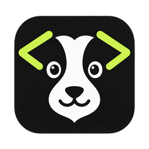
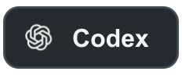
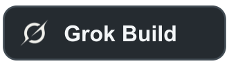
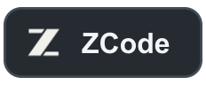
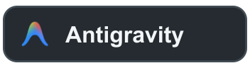
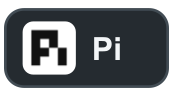
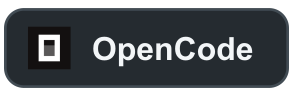
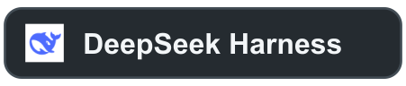

<!-- Keep feature scope aligned across README.md and docs/i18n/. Screenshots are shared PNG files. -->
<div align="center">



# dog.codes

**Todos os agentes de programação. Um só espaço. Comande de qualquer lugar.**

<a href="../../README.md">English</a> · <a href="../../docs/i18n/README.zh-CN.md">简体中文</a> · <a href="../../docs/i18n/README.zh-TW.md">繁體中文</a> · <a href="../../docs/i18n/README.ja.md">日本語</a> · <a href="../../docs/i18n/README.ko.md">한국어</a> · <a href="../../docs/i18n/README.es.md">Español</a> · <a href="../../docs/i18n/README.fr.md">Français</a> · <a href="../../docs/i18n/README.de.md">Deutsch</a> · <strong>Português (Brasil)</strong>

</div>

O dog.codes reúne agentes de programação, conversas, alterações de código e comandos do projeto em um aplicativo de desktop. Implemente uma funcionalidade com um agente, peça uma revisão a outro e depois execute o projeto e prepare o commit no mesmo espaço de trabalho. Quando você sai da mesa, comanda tudo pelo celular.

**Prévia de desenvolvimento · macOS primeiro.** Os instaladores e a validação da versão ainda estão em preparação. Já é possível executar pelo código-fonte; a validação no Windows está pendente. O app para celular (iOS e Android) está em desenvolvimento e ainda não está nas lojas de aplicativos.

[Site oficial](https://dog.codes) · [Funcionalidades](#features) · [Controle pelo celular](#phone) · [Primeiros passos](#getting-started)

## Agentes compatíveis

Conecte os agentes que você já usa. As 12 integrações abaixo estão implementadas; modelos, aprovações, dados de uso e recuperação variam conforme o agente e sua versão. Primeiro, instale e entre na conta de cada agente usando suas ferramentas oficiais.

<p align="center">
  <a href="https://developers.openai.com/codex/"></a>
  <a href="https://code.claude.com/docs/en/overview"></a>
  <a href="https://cursor.com/"></a>
  <a href="https://www.kimi.com/"></a>
  <a href="https://grok.com/"></a>
  <a href="https://z.ai/"></a>
  <br />
  <a href="https://antigravity.google/"></a>
  <a href="https://www.codebuddy.ai/"></a>
  <a href="https://pi.dev/"></a>
  <a href="https://opencode.ai/"></a>
  <a href="https://github.com/deepseek-ai/deepseek-harness"></a>
  <a href="https://kiro.dev/"></a>
</p>

## Todo o seu trabalho em um só lugar

<!-- Captura de tela pendente: ../../docs/images/readme/overview.png -->

<a id="phone"></a>

## Comande seus agentes pelo celular

**Deixe o notebook em casa. Seus agentes continuam trabalhando no seu computador enquanto o celular mantém o comando.**

Pareie um celular uma única vez e faça tudo abaixo de qualquer lugar. Seu código e seus agentes ficam no seu computador.

<!-- Captura de tela pendente: ../../docs/images/readme/phone-remote.png -->

- **Continue ou inicie conversas.** Retome qualquer conversa do seu computador ou comece uma nova: escolha agente, modelo e nível de raciocínio, acompanhe a saída ao vivo e pesquise, fixe, arquive ou ramifique sessões.
- **Aprove e responda.** Pedidos de permissão e perguntas dos agentes chegam ao celular com notificações push; um toque e o agente segue em frente. Cada aprovação é conferida com a execução original no seu computador.
- **Revise e faça commit.** Veja as mudanças em cada pasta do projeto, prepare arquivos, peça a um agente que escreva a mensagem do commit e então confirme, envie, baixe ou sincronize. Navegue pelo histórico de commits e compare branches em modo somente leitura.
- **Adicione projetos a partir do PC.** Navegue pelas pastas do seu computador e adicione uma como projeto sem voltar para a mesa.
- **Execute comandos no terminal do PC.** Abra terminais em qualquer pasta do projeto e trabalhe no shell de verdade do seu computador.
- **Execute o projeto e veja no celular.** Inicie as entradas de execução no computador e abra o app web em execução direto no celular.
- **Navegue por arquivos e envie anexos.** Leia os arquivos do projeto e anexe arquivos e imagens às suas mensagens.
- **Área de trabalho remota quando precisar.** Veja a tela do seu computador e toque, arraste, role, faça pinça, digite ou cole texto e imagens, com qualidade que se adapta à rede.

<!-- Captura de tela pendente: ../../docs/images/readme/remote-desktop.png -->

### Como a conexão funciona

- Escaneie um QR code uma vez, sem precisar de conta. A conexão é criptografada de ponta a ponta. Pareie vários computadores, veja quais estão on-line e revogue um celular quando quiser pelo app de desktop.
- O celular se conecta diretamente quando pode e, se não der, usa o serviço de retransmissão do dog.codes, que apenas encaminha tráfego criptografado.
- Seu computador precisa ficar ligado, com o dog.codes aberto ou minimizado. Enquanto houver trabalho ou uma sessão remota ativa, o dog.codes pode impedir que o computador entre em suspensão automática; você pode desativar isso.
- A área de trabalho remota funciona com computadores macOS, Windows e Linux (X11 e Wayland); o sistema operacional pede as permissões de tela e entrada necessárias.
- Status: o app para celular (iOS e Android) está em desenvolvimento e ainda não está nas lojas. A validação em dispositivos reais da área de trabalho remota e das notificações push ainda está em andamento.

<a id="features"></a>

## Recursos

### Passe o trabalho entre agentes sem interrupções

**Troque a qualquer momento o agente que executa a mesma conversa; o contexto é repassado automaticamente.**

- Entregue cada tarefa ao agente mais adequado: um desenha a arquitetura, outro cuida dos detalhes.
- Quando um agente esgota a cota, outro continua o trabalho sem que você precise repetir os requisitos.
- A conversa anterior acompanha a passagem, e o novo agente pode consultar turnos anteriores pelas ferramentas de histórico integradas — ele realmente continua, em vez de recomeçar.

<!-- Captura de tela pendente: ../../docs/images/readme/switch-agent.png -->

### Cotas e uso de relance

**Acompanhe cotas, uso, horários de renovação e versões dos 12 agentes de programação compatíveis em um só lugar.**

- Veja a cota restante e o horário de renovação de cada agente, planeje seu trabalho e aproveite cada token.
- Gerencie as versões dos agentes em um só lugar e atualize com um clique.
- Os agentes instalados e o status de login são detectados automaticamente.

<!-- Captura de tela pendente: ../../docs/images/readme/usage.png -->

### Use as assinaturas que você já tem

**O dog.codes executa as CLIs oficiais que você instalou e nas quais já fez login — Claude Code, Codex, Cursor e outras — com seus próprios planos.**

- Sem conta separada no dog.codes nem compra extra de API: os planos que você já paga continuam valendo.
- Local primeiro: seu código, suas conversas e suas credenciais ficam no seu computador. A conexão opcional com o celular é criptografada de ponta a ponta, então a retransmissão nunca vê seus dados.
- Os agentes são iniciados apenas com as variáveis de ambiente necessárias, sem expor seus outros segredos.

<!-- Captura de tela pendente: ../../docs/images/readme/accounts.png -->

### Revisão e correção de código entre agentes

**Peça a outro agente para revisar o código recém-alterado, encontrando bugs e falhas de design, ou para fazer uma análise de segurança ou desempenho.**

- Agentes e modelos diferentes revisam o trabalho uns dos outros com um olhar novo, evitando os pontos cegos de um único agente dentro de uma mesma conversa.
- Os achados são classificados em prioridade alta, média e baixa; escolha os que quiser e inicie a correção com um clique.
- A correção volta ao agente principal com o relatório de revisão e os achados escolhidos, sem perder o contexto.

<!-- Captura de tela pendente: ../../docs/images/readme/review-fix.png -->

### Ramifique entre agentes e compare abordagens

**Crie uma nova conversa a partir de qualquer turno e deixe outro agente tentar outra ideia, sem mexer na original.**

- Com worktrees, as alterações de código de cada abordagem ficam isoladas umas das outras.
- Peça a vários agentes que resolvam a mesma tarefa e fique com a melhor versão.

<!-- Captura de tela pendente: ../../docs/images/readme/fork.png -->

### Gerenciamento de Git com cara de familiar

**Operações de Git bem próximas do VS Code, para gerenciar o Diff na barra lateral do jeito que você já faz.**

- Preparar, remover da preparação, descartar, ignorar, Commit e Commit & Push, com visualização em árvore e em lista.
- Peça a qualquer agente que escreva a mensagem de commit com um clique, no idioma que você escolher.

<!-- Captura de tela pendente: ../../docs/images/readme/git-changes.png -->

### Descubra como executar um projeto e rode com um clique

**O dog.codes analisa como um projeto é executado e depurado e transforma esses comandos e scripts em atalhos clicáveis.**

- Chega de decorar o comando de início de cada projeto ou abrir um terminal só para isso — basta um clique.
- A saída fica reunida em um só lugar para você consultar quando quiser.

<!-- Captura de tela pendente: ../../docs/images/readme/run-project.png -->

### Projetos com várias pastas

**Frontend, backend e documentação em pastas separadas? Entregue tudo ao agente em uma única conversa.**

- Mesmo agentes sem suporte nativo a várias pastas conseguem trabalhar em projetos multipasta pelo dog.codes.

<!-- Captura de tela pendente: ../../docs/images/readme/multi-folder.png -->

### Minimize e continue trabalhando

**Tarefas, terminais, comandos do projeto e conexões do celular continuam enquanto dog.codes estiver aberto ou minimizado. Fechar a janela principal encerra o Core e seu trabalho.**

Apenas uma instância é executada; abrir novamente traz a janela existente para frente. Trabalho ativo exige confirmação antes de sair. Comandos interrompidos nunca são reenviados automaticamente.

- Enquanto houver tarefas, revisões, execuções, terminais ou sessões remotas ativas, o dog.codes pode impedir que o computador entre em suspensão automática (você pode desativar). Ele não impede que você feche a tampa ou bloqueie a tela.

<!-- Captura de tela pendente: ../../docs/images/readme/background.png -->

### Uso por turno, com toda a clareza

**Veja o consumo de tokens, a ocupação de contexto, os acertos de cache e o uso de cache de cada turno.**

- Entenda em detalhe o que a conversa atual e cada turno consumiram, e para onde foram seus tokens.

<!-- Captura de tela pendente: ../../docs/images/readme/turn-usage.png -->

### Cada envio, commit e push acontece uma única vez

**O dog.codes registra cada operação antes de executá-la e confere o resultado antes de tentar de novo.**

- Se o app fechar ou a conexão cair no meio de uma operação, ele verifica o que realmente aconteceu em vez de adivinhar: sem mensagens, commits ou pushes duplicados.
- Comandos interrompidos nunca são reexecutados automaticamente.

### A interface no seu idioma

**Use o dog.codes em 11 idiomas — English, 简体中文, 繁體中文, 日本語, 한국어, Español, Français, Deutsch, Português (Brasil), Русский e Italiano — ou siga o idioma do sistema.**

**Código aberto · Grátis · Multiplataforma**: licenciado sob Apache-2.0, feito para macOS, Windows e Linux, com o macOS validado primeiro.

<a id="getting-started"></a>

## Primeiros passos

Por enquanto, execute a partir do código-fonte. Instale **Rust 1.97.1**, **Node.js 22+**, **pnpm 11** e os [pré-requisitos do Tauri para sua plataforma](https://v2.tauri.app/start/prerequisites/). Clone ou baixe este repositório e execute na raiz:

```bash
pnpm install
pnpm desktop:dev
```

1. Instale e autentique pelo menos um agente compatível seguindo as instruções oficiais.
2. Abra o dog.codes, conecte um agente disponível e adicione as pastas do projeto.
3. Inicie uma conversa, escolha agente e modelo e descreva o trabalho.
4. Abra o painel de execução para descobrir comandos ou examine as alterações e peça uma revisão.
5. Para comandar seus agentes pelo celular, abra **Conectar celular** no app de desktop e escaneie o código de pareamento com o app do celular.

Conversas, análises de projeto, revisões e geração de mensagens de commit usam a conta do agente selecionado e podem consumir sua cota.

<details>
<summary>Para contribuir com o desenvolvimento</summary>

```bash
cargo test --workspace
pnpm check
```

`pnpm dev` abre uma demonstração da interface no navegador com dados simulados. Use `pnpm desktop:dev` para agentes e comandos reais.

</details>

## Mais informações

Leia o [CONTRIBUTING.md](../../CONTRIBUTING.md) antes de abrir um pull request e relate problemas de segurança de forma privada conforme o [SECURITY.md](../../SECURITY.md). Veja o [estado do projeto](../../docs/CURRENT_WORK.md) para acompanhar a implementação e a publicação, e as [notas de execução](../../docs/implementation/project-run-capabilities-2026-10-14.md) para o fluxo de comandos com um clique.

Apresentação inspirada no [codex-host](https://github.com/BytePioneer-AI/codex-host). Os ícones reutilizam os recursos já presentes neste repositório; veja a [origem e os avisos](../../apps/desktop/src/assets/licenses/README.md). Nomes de produtos e marcas pertencem aos respectivos titulares.
