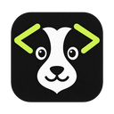

<!-- Keep feature scope aligned across README.md and docs/i18n/. Screenshots are shared PNG files. -->
<div align="center">



# dogcodes

**多个编程 Agent，一个工作台。**

<a href="../../README.md">English</a> · <strong>简体中文</strong> · <a href="../../docs/i18n/README.zh-TW.md">繁體中文</a> · <a href="../../docs/i18n/README.ja.md">日本語</a> · <a href="../../docs/i18n/README.ko.md">한국어</a> · <a href="../../docs/i18n/README.es.md">Español</a> · <a href="../../docs/i18n/README.fr.md">Français</a> · <a href="../../docs/i18n/README.de.md">Deutsch</a> · <a href="../../docs/i18n/README.pt-BR.md">Português (Brasil)</a>

</div>

dogcodes 把编程 Agent、对话、代码变更和项目运行命令放进同一个桌面应用。让一个 Agent 实现功能，换另一个检查代码，再运行项目、整理提交，整个流程都能在同一个工作台中完成。

**开发预览版 · macOS 优先。** 安装包和发布验收仍在准备中，目前可从源码运行；Windows 尚待验证。

[功能](#features) · [开始使用](#getting-started)

## 支持的 Agent

连接你已经在用的编程助手。以下 12 家 Agent 均已有接入；可用模型、审批、用量数据及恢复能力因 Agent 和安装版本而异。请先通过各 Agent 的官方工具完成安装与登录。

<p align="center">
  <a href="https://developers.openai.com/codex/"></a>
  <a href="https://code.claude.com/docs/en/overview"></a>
  <a href="https://cursor.com/"></a>
  <a href="https://www.kimi.com/"></a>
  <a href="https://grok.com/"></a>
  <a href="https://z.ai/"></a>
  <br />
  <a href="https://antigravity.google/"></a>
  <a href="https://www.codebuddy.ai/"></a>
  <a href="https://pi.dev/"></a>
  <a href="https://opencode.ai/"></a>
  <a href="https://github.com/deepseek-ai/deepseek-harness"></a>
  <a href="https://kiro.dev/"></a>
</p>

## 把开发流程放在一起

<!-- 截图占位: ../../docs/images/readme/overview.png -->

<a id="features"></a>

## 功能

### 多 Agent 无缝接续任务

**同一个对话中可随时更换执行的 Agent，自动交接上下文。**

- 随时把工作交给最适合的 Agent：擅长架构的负责设计，擅长细节的负责实现。
- 某个 Agent 额度用尽，换另一个 Agent 接着做，无需重新说明需求。
- 交接时会带上之前的对话内容，接手的 Agent 也能通过内置历史工具查阅过往记录，是真正接着做，而不是重新开始。

<!-- 截图占位: ../../docs/images/readme/switch-agent.png -->

### 随时掌握额度与用量

**集中管理 12 种 Coding Agent 的额度、用量、重置时间与版本。**

- 每个 Agent 的剩余额度和重置时间一目了然，方便安排工作，把每一份 token 都用足。
- 统一管理各 Agent 的版本，一键升级。
- 自动发现本机已安装的 Agent，并检测登录状态。

<!-- 截图占位: ../../docs/images/readme/usage.png -->

### 沿用你现有的订阅，无需另购 API

**直接调用本机已登录的 Claude Code、Codex、Cursor 等官方命令行工具，用的是你自己的订阅额度。**

- 不需要单独的 dogcodes 账号，也不必另外购买 API，已有的订阅直接派上用场。
- 本地优先：数据保存在你自己的电脑上，不经过任何中转服务器。
- 启动 Agent 时只传入必要的环境变量，你的其他密钥不会暴露给 Agent。

<!-- 截图占位: ../../docs/images/readme/accounts.png -->

### 多 Agent 代码审查并修复

**指定另一个 Agent 审查刚修改的代码，减少潜在 bug 与设计缺陷，也可进行安全与性能分析。**

- 不同 Agent、不同模型交叉评审，跳出原有上下文换个视角，避免单一 Agent 在同一上下文中的盲点。
- 评审结果分为高、中、低优先级，选中问题后一键「开始修复」。
- 修复交回主 Agent 执行，并附上审查报告与选中的问题，上下文连贯，改得更准。

<!-- 截图占位: ../../docs/images/readme/review-fix.png -->

### 跨 Agent 分叉，并行比较方案

**从任意一轮分叉出新对话，交给另一个 Agent 尝试不同思路，原对话不受影响。**

- 配合 worktree，不同方案的代码改动彼此隔离。
- 让不同 Agent 对同一问题各出一版，比较后择优采用。

<!-- 截图占位: ../../docs/images/readme/fork.png -->

### 符合使用习惯的 Git 管理

**高度贴近 VS Code 的 Git 操作逻辑，在侧边栏用熟悉的方式管理 Diff。**

- 暂存、取消暂存、丢弃、忽略，Commit 及 Commit & Push，树状与列表视图自由切换。
- 可指定任一 Agent 一键生成 Commit Message，并可指定语言。

<!-- 截图占位: ../../docs/images/readme/git-changes.png -->

### 自动分析项目运行方式，一键执行

**自动分析项目的运行、调试命令或脚本，转成可点击的快速启动项。**

- 不用再记不同项目各自的启动命令，也不必专门打开终端，点一下就能执行。
- 运行输出集中显示，随时查看。

<!-- 截图占位: ../../docs/images/readme/run-project.png -->

### 多目录项目支持

**前端、后端、文档分散在不同目录？一个会话全部交给 Agent。**

- 原本不支持多目录的 Agent，经 dogcodes 管理后也能进行多目录项目开发。

<!-- 截图占位: ../../docs/images/readme/multi-folder.png -->

### 关掉窗口，任务照跑

**Agent 执行、终端、项目运行都由后台服务负责，关闭窗口或面板不会中断工作。**

- 重新打开后自动接上原来的终端与输出。
- 断线或程序意外关闭后，能查到上次操作的实际结果，不会重复提交、重复推送。

<!-- 截图占位: ../../docs/images/readme/background.png -->

### 每一轮的用量明细一目了然

**每一轮的 token 消耗、上下文占用、缓存命中与缓存用量清清楚楚。**

- 详细掌握当前会话及每一轮对话的消耗，知道 token 花在了哪里。

<!-- 截图占位: ../../docs/images/readme/turn-usage.png -->

**开源 · 免费 · 跨平台**：Apache-2.0 授权，支持 Windows、macOS、Linux。

<a id="getting-started"></a>

## 开始使用

目前通过源码运行。先安装 **Rust 1.97.1**、**Node.js 22+**、**pnpm 11**，并准备好 [Tauri 平台依赖](https://v2.tauri.app/start/prerequisites/)。克隆或下载本仓库后，在根目录执行：

```bash
pnpm install
pnpm desktop:dev
```

1. 通过官方方式安装至少一个支持的 Agent，并完成登录。
2. 打开 dogcodes，连接可用 Agent，添加项目目录。
3. 新建对话，选择 Agent 和模型，描述要完成的工作。
4. 打开「运行」面板分析项目命令，或查看变更并发起审查。

Agent 对话、项目分析、审查和提交说明生成会使用所选 Agent 的账号，可能消耗对应额度。

<details>
<summary>参与开发</summary>

```bash
cargo test --workspace
pnpm check
```

`pnpm dev` 启动使用模拟数据的浏览器界面。连接真实 Agent 和运行项目命令请使用 `pnpm desktop:dev`。

</details>

## 更多信息

提交 Pull Request 前请阅读 [CONTRIBUTING.md](../../CONTRIBUTING.md)；安全问题请按 [SECURITY.md](../../SECURITY.md) 私下报告。功能与发布进度见[当前工作清单](../../docs/CURRENT_WORK.md)；一键运行的具体能力见[项目运行说明](../../docs/implementation/project-run-capabilities-2026-10-14.md)。

页面呈现参考 [codex-host](https://github.com/BytePioneer-AI/codex-host)。Agent 图标复用本仓库已有素材，来源与声明见[图标说明](../../apps/desktop/src/assets/licenses/README.md)。产品名称及商标归各自所有者。
