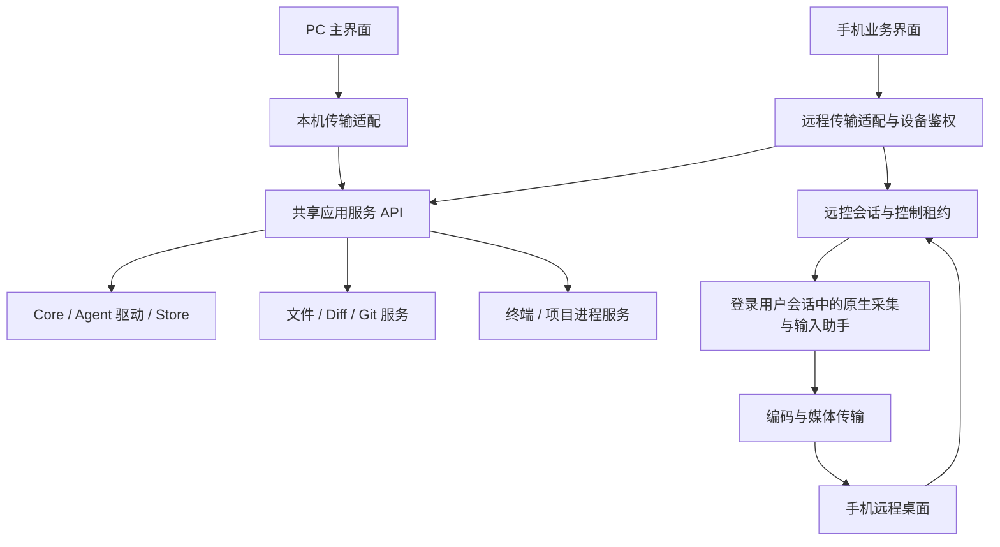
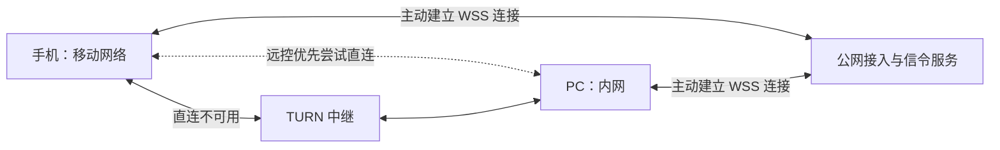

# 手机业务操作与跨平台远程桌面：可行性及改造评估

日期：2026-10-16。状态：远程访问首版产品范围已确认但排程后移，架构与技术选型仍为设计方案；尚未实施或完成三平台验证。

最新顺序：先完善桌面，在 GitHub 公开源码并提供 Windows/macOS/Linux 安装包，再推进本文的手机、官方服务与远控范围。当前执行 [桌面发布任务](desktop-github-release-work-breakdown-2026-10-16.md)；下文“首版”指未来远程访问首版，不是本次桌面 GitHub 首发条件。

基础改造例外：本机执行生命周期脱离窗口、全业务操作可靠性和后台共享状态已提到桌面发布前，分别由 DT-08/09/10 交付；本文对应部分作为后续接入手机的现成基础复用。设备配对、公网服务和媒体能力仍后续，不混淆本机基础与远程产品交付。

需求已拆为 [37 个实施子任务](remote-access-work-breakdown-2026-10-16.md)，覆盖本文件的 30 项验收；执行状态统一见 [当前工作清单](../CURRENT_WORK.md)。用户确认跨平台验证设备均可提供，具体环境由首项任务登记。

## 1. 结论与范围

可行。建议建设同一设备身份体系下的两种入口：手机原生业务界面通过共享服务操作 Coding Agent；远程桌面按需传输电脑画面并注入键鼠输入。前者覆盖新建会话、选择 Agent/模型/思考强度、流式消息、任务发送、审批、Diff/Git、文件、终端和项目运行；后者用于操作 IDE、浏览器及其他桌面应用。

本次为代码评估，不修改生产实现。三平台普通已登录桌面的采集和控制具有可行路径；登录前、锁屏、Windows UAC/安全桌面、无显示器和 Linux 不同合成器需分别验证，不能以普通桌面连通代替这些能力验收。

参考本地 `~/Workspace/opensource/rustdesk`，HEAD 为 `53996e3c4`，工作区存在修改。观察结论仅针对读取的本地实现，不视为上游版本保证。仅参考架构、状态机和问题处理思路；本方案不引入 RustDesk 源码、消息定义或它的服务端协议，不以 RustDesk 私有 fork 作为默认依赖。

### 1.1 后续讨论记录与决策状态

| 项目 | 状态与约束 |
| --- | --- |
| 手机业务操作与三平台远控 | 用户提出的目标；日常业务通过统一 API，屏幕与键鼠通过独立远控能力实现 |
| 无账号使用 | 用户明确不希望要求注册或登录服务端；以设备身份认证代替账号登录，不取消鉴权 |
| PC 显示二维码、手机扫码绑定 | 已确定扫码自动完成配对，详见 6.2，不增加默认二次确认步骤 |
| 移动网络连接内网 PC | 必须覆盖的使用场景；建议双方主动连接公网服务，业务走可靠转发，媒体直连优先、中继兜底 |
| Linux X11 | 用户已确认纳入远程访问首版，与 Wayland 一并支持；参考 RustDesk 的实现思路控制增量成本，独立实现并验收 X11 后端 |
| 手机 App | 尚未开发；采用 Flutter 方向，首版同时支持 iOS 和 Android，分别适配与验收；可参考 RustDesk 移动端实现思路，仍遵循不照搬源码和协议的约束 |
| 使用关系 | 首版面向个人，自己的手机连接自己的多台电脑；不交付他人分享、邀请或团队角色功能 |
| 配对授权 | 一次扫码绑定授予产品全部功能，之后连接和使用无需 PC 再确认，可随时撤销；不替代 Agent 原生操作审批或操作系统授权 |
| PC 运行状态 | 首版支持已登录后无人值守及关闭主窗口后后台继续工作；锁屏后仍可操作 Agent。远程解锁后续再做，重启未登录及无显示器运行不纳入本轮首版承诺 |
| 公网服务形态 | 用户已确定首版只提供官方接入与中继服务，不交付用户自建服务器入口或部署方案；无需账号登录的要求保持不变 |
| 覆盖地区与发布 | 首版同时覆盖中国大陆和海外；iOS/Android 先内测分发，稳定后再正式上架 |
| 初始规模与预算 | 先供个人及少量用户试用，具体容量和月预算后续再定；不据此承诺大规模并发或无限中继流量 |
| 项目网页预览 | 首版支持在手机 App 内打开并交互 PC 上运行的 Web 项目，同时保留通过远控操作 PC 浏览器 |
| 手机文件界面 | 首版只浏览项目文件和上传任务附件；不提供文件编辑、新建、重命名、删除或通用文件上传下载界面，修改通过 Agent 或远控完成 |
| 手机 Agent 管理界面 | 只显示安装状态和额度；安装、升级、配置修改及登录通过远控操作 PC 界面完成，会话中的 Agent/模型/思考强度选择仍保留 |
| 剪贴板 | 首版支持文本和图片双向传输，由用户手动发送或获取，不做自动同步 |
| 远控音频 | 首版只传画面和键鼠，不采集或传输 PC 系统声音，也不提供手机麦克风回传；App 内项目网页自身的音频不属于此项远控音频 |
| 多显示器 | 首版支持切换显示器，一次查看和控制一个屏幕，不提供多屏拼接总览 |
| 后台通知 | 待审批、待回答、任务完成和执行失败均推送提醒，支持按电脑或会话静音；点击后进入对应会话核实状态，不在通知上直接批准操作 |
| 离线新任务 | 保留手机本地草稿，重连后由用户点击发送；不提供自动发送队列 |
| 跨端草稿 | 未发送文字、附件选择、待发送模型和思考强度各端独立保存、互不覆盖；已发送内容、执行状态和审批结果始终共享 |
| 添加项目 | 手机选择 PC 已有目录并添加为项目；首版不提供手机原生的新建空目录或克隆仓库流程 |
| 离线历史 | 可查看手机已缓存的最近会话，明确标注离线及最后同步时间，支持清除缓存；未缓存内容需 PC 在线 |
| 自动睡眠 | 默认在任务执行或远控期间阻止 PC 自动睡眠，用户可关闭；不改变锁屏策略，不提供远程唤醒 |
| 库、加密握手模式与部署规格 | 尚未冻结；经技术探针及安全、兼容性验证后选择，不把候选方案写成已实现能力 |

### 1.2 手机端与后台运行边界

手机端从零建设，Flutter 作为当前方案方向，首版同时支持 iOS 和 Android；可参考 RustDesk 移动端的远控画面、触摸映射、键盘和连接状态处理思路，业务界面与协议按本项目需求设计。桌面 TypeScript SDK 不直接假定能在 Dart 中运行，应共享语言无关的协议 schema，并提供 Dart 客户端；是否通过 FFI 复用 Rust 传输实现由技术探针决定。发布采用先内测、稳定后正式上架的顺序；两端最低系统版本及具体内测分发渠道在实施计划中确定。核心业务、配对、媒体解码、输入和后台恢复均须在两端分别验收。

用户完成初次配对和系统授权、PC 已登录且未睡眠时，手机可无人值守连接。关闭主窗口不退出后台业务服务和必要的用户会话 helper；显式退出后台服务仍应使设备不可用。锁屏后会话、任务、消息、审批等 Agent 业务必须继续可用；需要解锁或系统交互的操作返回明确状态，不能把所有业务一并禁用。

首版不提供远程输入系统密码解锁的流程。锁屏时暂停桌面画面及键鼠控制、释放输入状态，手机显示“电脑已锁定，Agent 操作仍可用”；本机解锁后允许重新建立远控会话，所需系统授权照常处理。锁屏与睡眠分别报告，不能承诺电脑睡眠时继续执行或接收任务。

PC 提供“任务执行或远控期间保持唤醒”开关，默认开启；由后台服务统一持有系统防自动睡眠请求，关闭主窗口不丢失该状态。所有相关任务结束且远控会话退出后释放请求，用户关闭开关或退出后台服务时也应释放；多任务并行不能因其中一个结束而提前释放。锁屏不等于任务结束，防自动睡眠不阻止锁屏，也不等于强制保持屏幕点亮。

建议将仍未结束的 Agent 任务（含等待审批/回答）纳入任务保活，避免等待用户手机响应时电脑自动睡眠；仅打开空闲终端或留存历史不触发保活。项目长期运行进程的保活规则在生命周期设计中明确，不能因为后台始终存在就永久阻止睡眠。系统不支持、拒绝请求、用户主动睡眠、合盖或系统电源策略可能使服务不可用，应报告实际状态，不承诺强行阻止这些情况。

### 1.3 手机原生功能与远控分工

手机原生界面提供会话、任务、审批、Diff/Git、终端、项目运行、项目文件浏览、任务附件上传，以及 Agent 安装状态和额度查询。文件浏览不包含手机端文件编辑器、任意目录文件管理或通用上传下载；附件上传使用独立资源 ID 和受控暂存位置，不等同于直接覆盖项目文件。通过 Agent 或远控修改文件后，手机浏览和 Diff 应刷新。上述限制是手机界面范围，不撤回用户已确认的终端或远控权限。

手机可浏览 PC 当前用户可访问的已有目录并选择“添加为项目”，由宿主校验真实路径、访问权限和现有项目记录，返回稳定 projectId；同一目录重复添加应复用已有项目或明确提示，不生成无意重复项。目录选择器仅用于添加项目，不扩展为任意文件管理器。首版不提供手机原生的新建空项目目录、克隆 Git 仓库入口；需要时可通过已支持的终端、Agent 或远控完成，再添加已有目录。

Agent 安装、升级、全局配置和登录在 PC 界面进行，手机可进入远控完成。它们不属于首版手机原生管理页和新增远程管理 API 的交付要求。会话选择 Agent、模型、思考强度及审批模式仍属于手机业务功能。电脑锁屏或系统交互不可用时，相关管理操作提示需要本机解锁或处理，不承诺绕过首版锁屏边界。

项目运行页同时提供日志、运行状态和 App 内网页预览，远控 PC 浏览器保留为另一入口。预览通过已配对连接访问用户选定项目运行实例的开发服务，不能只把 PC 的 localhost URL 直接交给手机，也不能默认发布为任何人可访问的公网链接。

预览转发应覆盖 HTTP 请求/响应和 WebSocket 热更新，绑定 hostId、projectId、runId 与 previewId；仅转发已选定且获准的服务端点，不提供任意目标的开放代理。预览沿用设备认证、撤销及端到端内容保护；具体 WebView 到传输层的桥接方式在 P0 验证。不同项目/宿主的网页 origin、Cookie 和存储隔离，网页不得获得手机业务 SDK、配对凭证或具有主机权限的 JS 桥接。重定向、绝对 URL、额外 API 端口和 WebSocket 地址需要明确适配与失败反馈，不承诺所有开发服务器零配置可用。

## 2. RustDesk 中值得借鉴的边界

| 参考位置 | 观察 | 本项目采用的思路 |
| --- | --- | --- |
| `src/rendezvous_mediator.rs`、`src/server.rs` | 连接协商、直连及中继路径 | 将设备发现、信令和业务执行分开；网络路径可以变化而操作身份不变 |
| `src/server/connection.rs` | 会话授权及权限检查 | 每个会话有经过验证的设备身份；能力检查覆盖请求和事件订阅 |
| `src/server/video_service.rs`、`video_qos.rs` | 采集、编码、分辨率/码率/帧率调整 | 屏幕流单独调度、限制队列，优先交付当前画面 |
| `libs/scrap/` | 平台采集适配 | 统一采集接口下各平台独立实现，显式报告权限、显示器和会话状态 |
| `src/server/input_service.rs`、`libs/enigo/` | 输入映射、按键状态及释放处理 | 输入控制租约、按下/抬起状态、断线释放、坐标转换和文本输入分开设计 |
| `src/server/wayland.rs`、`rdp_input.rs` | Portal、PipeWire、输入后端差异 | Wayland 单独协商和验收，不能按 Linux 单一后端处理 |
| `rustdesk-server/src/relay_server.rs` | 中继转发独立于业务 | 公网中继不承载 Agent 业务和执行状态 |

视频编码、加密和网络穿透采用成熟标准及经选型验证的实现；自主设计本项目的应用协议，不重新发明加密协议或编解码器。

## 3. 当前项目可复用与必须调整的内容

### 3.1 可复用

- `crates/core`：Agent 驱动编排、会话、消息、审批、审查与事件订阅。
- `crates/protocol`：CommandEnvelope、CoreCommand、CommandAck、事件、状态与审批 DTO。
- `crates/store`：事实持久化、事件回放、命令幂等与任务版本。
- `crates/workspace`：现有工作区/Git 实现中的可复用逻辑。
- `packages/protocol/src/index.ts`：前端 CoreClient 与现有数据定义。
- `apps/desktop/src-tauri/src/daemon.rs`：本机 RPC、执行归属和订阅回放经验。

### 3.2 必须调整

> 2026-10-17 状态更新（见[远控核对](desktop-remote-readiness-audit-2026-10-17.md)）：第 1、3、4 条所述 Diff/Git、文件查询/监听、PTY 和项目运行已由 DT-08 迁入 daemon，TerminalHost 不再以窗口标签作资源 owner，窗口标签仅用于桌面入口授权；终端资源已有 id/epoch、offset 续读与缺口标记。尚待处理的是多附着尺寸归属与屏幕快照。第 2 条仍成立。另补两项：多步业务流程与待核实记录仍在桌面前端/localStorage（第 8 条），项目注册校验仍在桌面进程（第 9 条）。

1. **共享服务不完整。** Diff/Git 在 `review.rs`，文件与监听在 `workspace_browser.rs`，PTY 在 `terminal.rs`，项目运行在 `project_runs.rs`；这些实现依赖 Tauri State、WebviewWindow 或 Channel。应迁出可复用业务逻辑，Tauri 保留 UI 和传输适配。
2. **身份与授权目前按本地用户设计。** `daemon.rs` 的 execute 强制 actor=LocalUser；`core` 对响应审批、捕获工作区 Diff，以及部分 Artifact/恢复操作仍要求 LocalUser。需贯通可信 RequestContext，按设备和资源授权；不能通过把手机冒充 LocalUser 来兼容。
3. **进程生命周期绑定窗口。** TerminalHost 用窗口标签作为 owner；窗口销毁和输出发送失败可能清理会话。终端及项目进程应由后台服务拥有，订阅者离开和终止进程成为不同操作。
4. **资源标识需脱离窗口。** Diff 快照、监听、终端、项目运行使用稳定资源 ID、宿主重启 epoch 和租约；不使用窗口标签判断远程调用权。
5. **多端状态需明确归属。** Agent 启用/排序、置顶/归档等业务偏好迁为共享状态；未发送文字、附件选择、待发送模型/思考强度确定为各端独立草稿，不做跨端同步。已发送内容、任务状态和审批结果共享；主题、布局、键盘偏好保留每端设置。
6. **目录与附件需要远程语义。** 手机选择的是电脑上已有的项目目录；增加宿主目录浏览/注册与重复项目校验流程，不新增手机原生创建目录/克隆仓库流程。附件使用上传所得资源 ID，禁止把手机路径当电脑路径；文件界面仅浏览项目和上传任务附件，不据此扩展通用文件下载。
7. **能力契约需要统一。** CoreClient、ReviewClient、ProjectRunClient、TerminalApi 和组件中的直接 invoke，应落到统一 SDK 下的分域接口。新增错误码、能力查询和契约兼容测试。
8. **多步业务流程需后台化。** 发送（切换 Agent）、开始修复、审查启动、Fork 等由桌面 TypeScript 编排，待核实记录只在本机 localStorage；手机若直接复刻会产生语义分叉，且两端无法互相发现、接续。应由后台持有意图与阶段，客户端只提交、查询和订阅。
9. **项目注册需在后台校验。** 路径规范化、去重、ID 生成和互斥目前在 Tauri 进程，Core 只做非空检查；手机添加项目前需迁入后台并带操作身份。

## 4. 建议架构



统一的是业务契约、身份、资源和操作语义；控制请求、事件、文件和视频可以使用不同传输通道。高频视频和鼠标移动不写入 Canonical Event/SQLite。

建议逐步形成以下模块，名称为提案，实施时按依赖决定合并或拆分：

| 模块 | 职责 |
| --- | --- |
| `application-api` | 客户端无关的服务接口、能力、错误和授权上下文 |
| `host-service` | 持有 Core、工作区服务、终端、项目进程和操作记录；从桌面启动壳中独立 |
| `remote-gateway` | 设备配对、认证、撤销、连接/订阅、速率与资源边界 |
| `remote-desktop` | 远控会话、显示器、控制租约、采集/输入 trait 和媒体调度 |
| 平台 helper | Windows/macOS/Linux 的桌面会话与系统 API 适配 |
| `packages/client-sdk` 与 Dart 客户端 | 基于共享 schema 的业务模型与接口，各端提供本机或远程 transport；Flutter 不直接依赖 TypeScript SDK |
| 官方信令/中继服务 | 设备在线路由、会话信令和必要的密文转发；首版仅提供官方服务 |

当前工作区 `unsafe_code = forbid`。原生 API 的 FFI 应放在范围明确的独立平台适配 crate 或 helper 中，经过局部审查；Core、协议和业务服务继续保持现有约束。

## 5. 新协议建议

### 5.1 API 域

| 域 | 代表操作（建议名称） |
| --- | --- |
| `host` / `device` | capabilities、pair、revoke、status、desktopSessions |
| `hostDirectory` | list、validate；按宿主当前用户权限选择已有目录，用于项目注册 |
| `project` / `conversation` | list、create、rename、archive、delete、fork、setExecutor、setPreferences |
| `agent` / `model` | installations、enabledAgents、models、thinkingOptions、permissions、quota |
| `turn` / `approval` | submit、cancel、pending、respond |
| `review` / `diff` | start、cancel、results、snapshot、file、release |
| `git` | status、stage、unstage、discard、commit、push、pull、sync、operationStatus |
| `workspace` / `artifact` | 项目 roots、list、search、read、watch；任务附件 upload 与必要的内容读取；不提供首版通用文件管理 API |
| `terminal` | create、list、attach、detach、write、resize、terminate |
| `projectRun` | catalog、analyze、edit、start、list、attachOutput、stop |
| `preview` | create、status、close，以及授权开发服务的 HTTP/WebSocket 转发；绑定项目运行实例 |
| `desktop` | displays、startView、stopView、requestControl、releaseControl、input、sessionStatus |
| `clipboard` | read、write；仅在用户手动操作时传输文本或图片，图片使用受控二进制资源 |

查询、命令、操作进度和流式事件都需有契约，不把所有功能强行塞进 CoreCommand。OS 选择框、打开本机应用等宿主 UI 行为作为端能力处理；远程业务接口返回数据或资源。

### 5.2 请求与操作

控制消息初版采用有 schema 的 JSON，复用现有 serde/TypeScript 类型；二进制文件、PTY 数据和媒体独立传输。以下为示意，不是已冻结协议：

```json
{
  "protocolVersion": 1,
  "requestId": "req_...",
  "operationId": "op_...",
  "hostId": "host_...",
  "method": "git.commit",
  "resource": { "projectId": "prj_...", "rootId": "root_..." },
  "precondition": { "snapshotId": "diff_...", "expectedHead": "..." },
  "params": { "message": "Fix startup handling", "stagingPolicy": "staged_only" }
}
```

- 身份由已经认证的连接产生 RequestContext；客户端不能自报 LocalUser 或提升权限。
- 64 位序号在线路上统一为十进制字符串，避免 JavaScript 精度差异；明确版本协商、必需能力与不支持错误。
- `requestId` 用于本次收发关联；`operationId` 用于逻辑操作、重连查询与去重。服务校验同一个操作 ID 的请求摘要相同，按宿主、主体和操作 ID 保存记录。
- 回执区分 received/accepted/running/succeeded/failed/cancelled/indeterminate；提交被接受不等于 Git 已提交或 Agent 已执行完成。
- Core 的事务内幂等与版本校验继续复用。Git push、启动外部进程等存在崩溃不确定窗口，需先持久化操作意图，恢复时检查实际 Git 状态或进程身份；不能声称所有外部副作用 exactly-once，也不自动重发结果未知的操作。
- `git.commit` 明确暂存策略和预览指纹；`commit_and_push` 如作为组合操作，应分别记录两步结果，支持“提交成功，推送失败”。
- 错误返回稳定 code、用户文案、retryability、resource 和 operationId；版本冲突、过期审批、权限不足、网络断开、结果未知分别处理。

### 5.3 事件与流

- 会话/审批/审查：保留持久事件序号与补齐；远程订阅按授权项目过滤，不直接广播全部全局事件。游标缺口或保留期超限时重新取快照。
- PTY：独立 terminalId、streamEpoch、输出 offset 和有限缓存；支持 attach 后从 offset 补齐，缓存缺口显式报告。另行定义终端屏幕快照/重置语义，不能只补最后一段 ANSI 字节就假定能恢复画面。
- 项目进程：独立 runId、启动/退出状态、退出码、输出流；手机暂时离线不等同于停止。
- 项目文件读取与任务附件上传：大内容按需分块、校验及续传；项目读取按 project/root/relativePath 限定，上传写入受控附件存储，不直接覆盖项目路径。沿用并复核现有路径及符号链接检查，目录变化通知用于刷新浏览与 Diff；不以通用流协议扩张手机文件管理范围。
- 不同流分别设置优先级、背压和内存预算，文件下载与视频拥塞不应堵塞审批响应。

### 5.4 远控会话与输入

- 查看与控制为不同能力。会话明确 host、OS 用户会话、displayId、显示器布局 revision、画面尺寸/缩放/旋转及权限状态。
- 同一桌面初版只允许一个有效键鼠控制租约，可同时只读查看；本机用户可以中止控制。业务 API 并发仍使用资源版本/锁，不套用全局单控制者限制。
- 键盘消息区分物理键、修饰键、文本输入和组合键；中文输入不能仅发送手机键码。手机双指滚动、长按右键、拖拽、缩放/平移应明确映射。
- 输入携带 controlLease、connectionEpoch、sequence 和 displayRevision。旧连接的点击/按键不得在重连后回放；重复消息不重复注入。
- 鼠标移动可合并丢弃旧位置；点击包含目标坐标，按下/抬起使用可靠有序通道，不能依赖另一路无序移动先到。远控代理维护按键/鼠标按钮状态，失去租约、断线或过期后释放。
- 坐标在显示器局部空间内传输，由宿主统一转换逻辑/物理像素、缩放、旋转和多屏负坐标；显示布局变化后拒绝旧布局输入并刷新。
- 业务事件可回放，键鼠动作不可离线排队回放。
- 多显示器采用逐屏切换，每个远控查看会话只传输和控制当前选中屏幕。切屏时释放已按下的键鼠、更新显示器与布局版本，拒绝旧屏幕输入；显示器被移除时暂停输入并要求选择可用屏幕，不能将旧坐标直接应用到另一屏幕。不提供多屏拼接总览。
- 首版远控不传输 PC 系统音频或手机麦克风，不为此请求音频采集权限；App 内项目网页自行播放声音按普通网页能力处理。

### 5.5 手动双向剪贴板

用户在当前电脑的远控界面主动选择“发送到电脑”或“获取到手机”，传输文本或单张图片；不后台轮询或自动同步剪贴板。平台读取/写入权限和用户交互要求按各端实现，首版需在 iOS、Android 与三平台宿主分别验证。动作执行前后明确展示目标电脑和成功/失败状态，切换电脑时不将未完成请求重新路由到新宿主。

文本采用统一字符编码，图片协商支持的格式并限制编码体积、解码尺寸和内存占用；超限或格式不支持应明确提示，不悄悄截断或降级为文件路径。首版范围为纯文本和图片，不承诺富文本、文件列表或任意文件传输。手机相册/系统分享导入的任务附件仍走独立附件流程。

剪贴板沿用已配对身份、端到端内容保护及撤销语义。读取结果只用于这次手动操作，写入是设置目标剪贴板，不自动向目标应用发送粘贴快捷键；实际粘贴由用户触发。断线后写入结果未知时提示核实，不自动重放旧内容。图片走有界二进制通道，不将其写入会话事实事件或服务日志，及时回收传输缓冲和临时资源。

## 6. 网络方案

### 6.1 移动网络与内网 PC 的连接

建议首版控制/事件使用 TLS 保护的可靠连接，公网提供 PC 与手机主动出站连接的 WSS 路由；配对后在端点建立经验证的端到端加密会话。LAN 直连与公网转发共用应用消息和授权语义。不要把现有 loopback RPC 直接改为监听公网。

远程桌面媒体优先评估 WebRTC：媒体轨传输画面，DataChannel 传键鼠及远控控制数据，直连失败使用 TURN 中继。业务 API 不依赖媒体会话存在；只查看会话和审批时不启动屏幕采集。WebRTC 的信令需要应用另行提供，ICE/STUN/TURN 用于连接协商与中继，这是标准支持的分层。[WebRTC 官方说明](https://webrtc.org/getting-started/peer-connections)

配对身份必须绑定远控握手和媒体连接指纹；中继转发消息不能替换成另一个未经配对的端点。加密握手选成熟实现，不自定义密码学。设备权限建议分 conversation.read/write、approval.respond、git.write、terminal.execute、workspace.read、desktop.view/control；执行终端或完整桌面控制具有很广的实际权限，不能向用户承诺仍受只读文件范围限制。

基础设施分别预算控制流量与媒体中继流量。仅作成本量级示例：一条平均 4 Mbit/s 的视频流一小时约为 1.8 GB 单向有效载荷，尚未计协议开销和中继服务商计费方式。手机前后台切换后重建订阅，后台通知只作唤醒提示，恢复后从宿主核实当前审批。

PC 不要求公网 IP、路由器端口转发或与手机处于同一局域网；PC 和手机分别主动连接公网服务，由服务沿已建立的连接路由消息。局域网直连作为优化，不作为首次绑定前提。



| 数据 | 首版建议路径 |
| --- | --- |
| 会话、任务、审批、Git、事件与业务输出 | WSS/HTTPS 接入与路由；端点间另有认证和加密，不依赖远控媒体建立成功 |
| 画面与远控输入 | WebRTC，通过 ICE 选择可用路径；STUN 辅助发现映射，TURN 提供中继 |

仅部署 STUN 或只尝试打洞不能保证跨网连通。需要部署可用的 TURN，并测试 UDP 不可用时的 TCP/TLS 路径。TURN/TLS 可配置在 443，但不等同于 HTTPS，严格企业代理仍可能阻断。两端离线、PC 睡眠、网络完全封锁或中继不可达时，不承诺连接成功。[TURN 说明](https://webrtc.org/getting-started/turn-server)、[TURN 标准](https://www.rfc-editor.org/rfc/rfc8656.html)

首版由官方提供接入、信令、业务密文路由及 STUN/TURN，不要求用户自建或配置服务器，覆盖中国大陆和海外。服务可在早期按区域共用主机，按实测带宽和连接数拆分；中继不可成为公开代理，须有设备认证、短期授权和资源限额。推送服务按移动平台及实际地区网络另行接入，不承担命令执行或审批事实存储。首批仅供个人及少量用户试用，容量、节点、流量策略和预算在部署前根据探针结果确定。

### 6.2 无账号扫码配对

默认流程为“PC 点击连接手机 → 手机 App 扫码 → 自动完成绑定 → 显示电脑卡片”，不要求注册、邮箱、密码或登录服务端。PC 用户主动开启配对窗口代表允许添加自己的设备；配对页说明将授予全部产品功能，包括 Agent、Git、文件、终端和远程桌面查看/控制，扫码成功后展示新设备并提供撤销入口。之后连接和使用这些功能无需 PC 再确认，不增加每次远控的本机同意步骤。Agent 原生操作审批，以及操作系统要求的屏幕录制、辅助功能或 Portal 授权仍单独处理，配对不能绕过这些权限。

手机和 PC 分别生成独立设备密钥，私钥保存在相应平台的安全凭据存储中；具体存储适配与备份策略在实施时验证。二维码建议包含：

| 字段 | 用途 |
| --- | --- |
| 协议版本、接入服务地址 | 协商能力及官方服务路由；客户端校验官方可信服务配置，首版不提供自托管入口 |
| PC 设备 ID | 定位路由，不作为授权凭证 |
| PC 身份公钥或指纹 | 手机核验远端身份，阻止中继替换目标 |
| 临时配对 ID | 定位本次配对窗口 |
| 高熵一次性随机密钥 | 证明扫码者持有本次授权凭证 |
| 过期时间 | 建议有效期 2 分钟，具体值可调整；由 PC 校验 |

二维码不包含长期私钥；一次性随机密钥不明文发送给中继、不放在 HTTP URL 查询参数或日志中。手机经路由与 PC 建立端到端配对握手，验证 PC 身份并证明持有一次性密钥，同时将手机公钥绑定到这次握手。PC 原子地消费凭证并持久化手机公钥、授权范围、设备名称和授权版本；手机保存已验证的 PC 身份。完成回执丢失时，只允许同一已认证手机查询配对结果，不再次添加其他设备。

二维码过期、关闭配对页、重新生成或成功使用后，旧凭证失效；两个手机同时扫码时只允许一个成功。有效二维码等同临时授权，拿到截图的人也可能配对，因此不长期展示或记录二维码内容。设备名称仅用于展示，不能用于认证。

加密握手采用成熟协议及库。Noise 的公钥与预共享密钥能力可作为选型候选；具体模式、身份绑定和密钥派生须一并验证，不直接将示意字段当作完整密码协议。[Noise 协议](https://noiseprotocol.org/noise.html)

### 6.3 后续连接、权限与解除绑定

- 后续连接无需再次扫码或账号登录。双方证明持有已配对身份对应的私钥，每次连接建立新会话密钥；不能重复使用二维码密钥作为长期访问令牌。
- 公网服务通过设备密钥认证接入，并使用受限路由授权；设备 ID、公钥或配对 ID 本身不能授权订阅、转发或分配 TURN 资源。服务端设备认证方式和路由授权格式需在协议设计阶段确定。
- PC 保存授权事实并最终校验请求。中继不能替 PC 授权；手机声明的权限、Actor 或设备名称不可信。已有 `PairedDevice` 语义应贯通共享应用服务。
- 首版面向个人设备，一部手机可绑定自己的多台 PC；一台 PC 配对多部自有手机作为兼容方向，每一对关系独立记录和撤销。PC 提供设备列表、重命名、最后连接时间和解除绑定。首版统一授予全部产品功能，不交付按设备勾选权限、他人分享、邀请或团队角色界面；服务端仍保留身份和能力校验。
- PC 撤销设备后，终止其现有订阅与远控租约、释放键鼠状态，拒绝新请求及旧凭证恢复。已经开始的 Agent/Git/进程操作不默认回滚或终止，仍按操作生命周期管理。
- 换手机、重装或密钥丢失后，首版重新扫码，不提供账号找回。PC 身份密钥变化时不得仅凭相同名称或设备 ID 静默信任新身份。

### 6.4 弱网与后台生命周期

手机切换 Wi-Fi/移动网络后重建传输，按游标补齐业务事件，必要时重新协商远控连接；任务和 Git 通过 operationId 核实结果，结果未知时不盲目重发。屏幕旧帧可丢弃，键鼠动作不可回放。业务连接与媒体连接分别报告状态，媒体失败不应将正在执行的 Agent 任务标为失败。

手机进入后台或关闭 App 不终止 PC 上的 Agent、终端或项目进程。首版对待审批、待回答、任务完成和执行失败提供系统推送，并允许按电脑或会话静音。通知到达和后台唤醒不保证实时；点击后进入正确宿主和会话，从 PC 核实当前状态，不提供通知内直接批准操作。推送默认只携带最少提示信息，不包含任务正文或审批凭证。

通知按宿主、会话和事件身份去重；电脑静音覆盖其下所有会话，会话静音只影响该会话。静音仅抑制系统提醒，不隐藏 App 内真实待办或失败状态。建议首版将静音偏好归属接收通知的手机，并在官方推送路由中持久化必要规则，避免依赖被系统挂起的 App 拦截；推送 token 绑定已认证设备和有效配对，解除绑定后停止对应通知。迟到通知指向的审批若已处理、失效或会话已删除，应显示当前状态，不重建旧操作。

PC 离线或连接断开时，新任务只保留为手机本地草稿，不提交服务端自动发送队列。重连后刷新会话、模型和审批能力，由用户再次点击发送；审批响应、Git 和终端命令也不离线排队。若断线发生在发送之后，显示结果待核实并通过原 operationId 查询；不能把已经接受的任务重新当作未发送草稿自动执行。

各端独立持久化草稿，按 hostId/projectId/conversationId 隔离；手机与 PC 的未发送文字、附件选择、模型和思考强度互不覆盖。已发送的模型配置属于历史执行事实，不反向覆盖另一端现有草稿。附件上传完成不代表任务已发送；重连后检查资源是否仍有效，手机文件访问授权丢失时提示重新选择，不因恢复草稿自动上传或提交任务。远端删除会话、移除模型或撤销设备时提示草稿无法按原目标发送，不悄悄改投其他会话或模型。

手机本地缓存最近已打开会话的已同步内容，PC 离线时可以只读查看，展示“离线缓存”和最后同步时间；部分历史未缓存时明确显示缺口，不能将缓存中的运行或审批状态当作实时状态。缓存不是第二份业务事实源，不承诺离线可看全部历史、附件、项目文件或实时 Diff。重连后按宿主事实补齐和纠正状态，不以本地缓存覆盖 PC。

提供清除会话缓存入口，与删除 PC 会话、清除草稿和解除配对分开；清除缓存不应删除密钥或未发送草稿。本地缓存使用平台应用私有存储及相应数据保护，按宿主隔离、限制容量并回收旧内容，具体条数和体积由实现确定。用户主动解除绑定或手机得知授权撤销时清除对应会话缓存；无法保证远程清除一台始终离线设备上已经存储的数据。收到远端会话删除事件后移除相应缓存，未连接时仍标注其最后同步时间。

PC 关机、休眠、注销导致所需服务不可用，或网络/中继故障时，应显示离线、重连中、最后在线时间或可诊断错误，而不是显示操作完成。唤醒关机/睡眠电脑不包含在这条通信链路的保证中。

### 6.5 官方服务覆盖与内测交付

中国大陆和海外均为首版服务范围，测试矩阵覆盖两端同地区及手机/PC 跨地区的实际连接。区域路由、中继回退和通知渠道须以可达性实测选型，不假定单一节点、推送提供方或开发者当前网络可以代表所有用户。地区切换不能改变设备身份或要求重新配对；服务端持久化最少的认证、路由和通知元数据，业务事实仍保留在 PC。

首批面向个人及少量用户，先交付 iOS/Android 可安装的内测版本，以及匹配的三平台 PC 版本和官方服务。验证稳定后再推进正式应用商店上架，正式上架不作为首批内测包的完成条件。内测准入和安装渠道不引入产品内账号登录要求，具体发包方式在实施时确定。

用户尚未指定人数、在线 PC 数、同时远控数或月预算。技术探针和小规模试用记录直连率、建立连接耗时、交互延迟、媒体中继带宽、推送到达及恢复表现，再据此给出具体资源配置、容量和成本估算。部署前需要明确实际资源上限与费用预算；本轮需求讨论不预设供应商、采购或付费部署授权。

## 7. 三平台实现与边界

| 平台 | 建议采集/输入路径 | 交付边界 |
| --- | --- | --- |
| Windows | Desktop Duplication 为桌面采集候选；SendInput 处理常规键鼠；硬件编码单独验证 | 用户会话 helper 处理桌面，系统服务若存在则承担启动/会话协调；普通权限不能覆盖所有提权或安全桌面场景 |
| macOS | ScreenCaptureKit；CoreGraphics 输入事件；系统辅助功能授权；原生编码候选 VideoToolbox | 由有图形会话的用户 helper 工作；屏幕录制与控制权限分别检测；签名、权限撤销、锁屏和重启恢复分别验收 |
| Linux X11 | 首版必需的 X11 采集与输入后端 | 在目标用户图形会话内运行；多屏、DPI、桌面切换单列测试 |
| Linux Wayland | ScreenCast/RemoteDesktop Portal、PipeWire；按实际能力使用 EIS/libei 或 Portal 输入方法 | 按 GNOME/KDE 和 Portal 后端版本验证；恢复授权依赖系统支持，不能承诺所有发行版免交互无人值守 |

Windows 官方文档说明 Desktop Duplication 可获得桌面帧及更新区域；SendInput 受完整性级别限制；系统服务处于 Session 0，应通过用户会话中的程序协作。对应本方案应将 GUI helper 与后台业务服务分离，而不能让一个系统服务直接承担所有捕获与控制。[桌面采集](https://learn.microsoft.com/en-us/windows/win32/direct3ddxgi/desktop-dup-api)、[输入限制](https://learn.microsoft.com/en-us/windows/win32/api/winuser/nf-winuser-sendinput)、[服务与用户会话](https://learn.microsoft.com/en-us/windows/win32/services/interactive-services)

macOS 采集使用 ScreenCaptureKit，控制权限须由系统授予；许可被撤销时服务返回明确的 permission_required，保留可用的业务 API。[ScreenCaptureKit](https://developer.apple.com/documentation/screencapturekit/capturing-screen-content-in-macos)、[辅助功能授权](https://support.apple.com/en-sg/guide/mac-help/mh43185/mac)

Wayland Portal 的会话支持设备选择、用户授权及有条件的恢复令牌；恢复失败时仍可能重新询问用户。通过 ConnectToEIS 建立输入连接后不应再混用 Notify 输入路径。[RemoteDesktop Portal](https://flatpak.github.io/xdg-desktop-portal/docs/doc-org.freedesktop.portal.RemoteDesktop.html)、[ScreenCast Portal](https://flatpak.github.io/xdg-desktop-portal/docs/doc-org.freedesktop.portal.ScreenCast.html)

视频编码首版验证手机可解码的共同格式（例如 H.264 与 VP8 候选），明确最低系统版本与软/硬件回退。是否采用某个 Rust WebRTC/编码库，应以 iOS/Android 解码、跨平台构建、性能和维护情况的原型结果确定，不在本评估中锁定未经验证的依赖。

### 7.1 Linux X11 的范围与工作量

用户已确认远程访问首版同时支持 X11 与 Wayland，X11 不再作为可选或延期后端。采用独立采集与输入适配，共用设备认证、协议、编码、媒体传输和手机控制界面；参考 RustDesk 的实现思路控制工作量，不照搬源码或协议。具体发行版、桌面及最低版本在 P0 中确定，但不能以选型结果直接省略 X11。

业务 API 与显示系统解耦，在 X11、Wayland 和无桌面环境中按实际宿主能力提供会话、审批、Git、文件、终端及项目运行。X11 采集或输入初始化失败时应报告具体错误并保留可用的业务能力；声明支持的 X11 环境必须通过屏幕查看及键鼠控制验收。

Ubuntu 25.10 已移除 GNOME 的 Xorg 会话，KDE 计划从 Plasma 6.8 起只提供 Wayland 会话；Xfce 4.20 的 Wayland 支持仍属实验阶段，旧发行版与桌面仍有 X11 使用需求。Wayland 桌面中的 XWayland 应用随桌面捕获，不因这些应用存在就需要独立 X11 桌面后端。[Ubuntu 公告](https://discourse.ubuntu.com/t/ubuntu-25-10-drops-support-for-gnome-on-xorg/62538)、[KDE 公告](https://blogs.kde.org/2025/11/26/going-all-in-on-a-wayland-future/)、[Xfce 说明](https://xfce.org/about/tour)

本地 RustDesk 的 `libs/scrap/src/x11/capturer.rs` 使用 XCB 与共享内存采集，`iter.rs` 使用 RandR 枚举显示器；`libs/enigo/src/linux/xdo.rs` 提供输入适配，平台及输入服务另有光标、DISPLAY/XAUTHORITY 和按键释放处理。只借鉴分层与问题清单，自行实现本项目后端。

下表为熟悉 Rust/Linux 的工程师在公共链路已就绪条件下的增量估算，未经原型验证，不是交付承诺。前提包括设备配对、鉴权、网络、中继、编码、手机解码和控制 UI 已可复用；不代表本项目从当前状态完成全部远控的总工期。

| 增量工作 | 估算 |
| --- | --- |
| X11 会话识别、连接与权限错误 | 1～2 人日 |
| 画面采集、像素格式及公共编码接入 | 2～4 人日 |
| 鼠标、快捷键、文本输入与断线释放 | 2～4 人日 |
| 多屏、光标、分辨率变化和坐标映射 | 2～3 人日 |
| 打包依赖、目标环境验证与修复 | 3～7 人日 |
| 合计 | 10～20 人日，单人约 2～4 个工作周 |

单屏演示估计 2～4 人日，不能替代交付验收。上述增量范围面向已登录桌面；中文文本输入需验证目标应用，完整输入法组合行为不能默认保证。登录界面控制、无显示器虚拟桌面、多用户切换及大量发行版/显卡组合另行估算，可能再增加数周。测试机器可用性和环境问题会影响实际日历工期。

## 8. 实施顺序与完成门槛

| 阶段 | 交付内容 | 完成门槛 |
| --- | --- | --- |
| P0：技术探针 | Windows/macOS/Linux X11/Linux Wayland 四条采集与输入路径的小原型；手机解码/中文输入；扫码配对、网络直连与 TURN 试验 | 每条路径在真实环境输出能力矩阵、权限状态、帧率/延迟与失败原因；验证无账号绑定及移动网络接入，确定各后端支持的桌面、最低版本和依赖 |
| P1：统一业务服务 | 抽离文件/Diff/Git/终端/项目运行，可信身份与分域契约，操作记录和 SDK；后台生命周期及默认可关闭的防自动睡眠策略 | PC 先通过共享服务完成原有日常操作；跨端接口契约测试通过，关闭 UI 不终止后台任务，保活请求能按任务/远控生命周期正确获取和释放 |
| P2：手机业务闭环 | 无账号扫码配对/撤销、多设备授权、LAN 与公网可靠控制通道；已有目录添加项目；会话与离线缓存、独立草稿、审批、Diff/Git、项目文件浏览、任务附件、终端、运行项目与网页预览；Agent 安装状态/额度查询 | iOS/Android 通过移动网络操作内网 PC 的真实项目，无需端口转发；审批竞争只成功一次，断线能核实 Git 结果，终端可重连、输出缺口可识别；目录添加、缓存清除、手动恢复发送、网页预览交互和热更新通过验证 |
| P3：三平台远程桌面 | 用户会话 helper、采集编码、媒体传输、查看/控制切换、键鼠/中文输入、逐屏切换、手动双向文本/图片剪贴板；Linux 同时交付 X11 与 Wayland 后端，不传系统音频 | Windows、macOS、Linux X11、Linux Wayland 目标环境均完成手机查看、点击、拖拽、滚动、快捷键、中文、切屏、剪贴板、断线释放及适用的拒绝/撤销权限验证 |
| P4：内测发布与长期稳定性 | 中国大陆/海外官方服务、iOS/Android 内测分发；用户服务启动、签名安装、升级、弱网恢复、资源预算、跨版本能力兼容 | 小规模内测在声明支持的三平台/桌面环境通过长时间运行、地区/网络切换、主窗口退出重开和宿主重启验证；形成容量与成本报告，稳定后另行推进正式上架 |

这是两类子系统及客户端接入的工程，不能以一个平台的截屏与点击演示判定全功能完成。开发阶段应以明确的矩阵逐项收口；远程访问首版包含三平台以及 Linux X11、Wayland 两条后端路径，不因分阶段实施而省略。

已登录后无人值守、关闭主窗口后的后台运行，以及锁屏后的 Agent 业务属于首版范围。远程解锁后续再做；登录前、Windows 安全桌面、无头/虚拟显示器不纳入本轮首版承诺。手机原生文件界面限于浏览项目与上传任务附件，Agent 管理限于安装状态/额度查询，其他管理通过远控完成。首版包含手动双向文本/图片剪贴板与逐屏切换，不包含自动剪贴板同步、多屏拼接总览、PC 系统声音或手机麦克风回传。

## 9. 建议的核心验收用例

1. PC 和手机新建/选择会话、Agent/模型/思考强度；手机发送，两个端一致显示正文、工具活动、状态和终态。
2. 同一审批两端竞争响应；过期审批、设备撤销和断网后的旧请求不会产生额外授权。
3. 手机查看 Diff、部分暂存、提交和推送；并发修改、提交成功后断线、推送失败均可查询明确结果。
4. 手机启动终端和项目，退出页面/断网后进程继续；重新进入可定位同一资源，显式停止后子进程回收。
5. PC 主窗口关闭后，业务接口和远控用户 helper 按配置继续工作；退出后台服务、系统睡眠和注销则返回真实不可用状态，不伪造在线。
6. 三平台权限拒绝/撤销、显示器热插拔、缩放/旋转及会话切换；错误坐标和旧输入租约被拒绝。
7. 手机断网时正按住 Ctrl 或鼠标拖拽，宿主释放输入；重连不回放旧按键和点击。
8. 视频/文件大流量下审批与取消仍能及时交付；限速、丢包及网络切换后不积压旧画面。
9. 多设备身份隔离、重放与撤销、旧客户端能力协商和不可用能力提示。
10. PC 主动打开配对页面，移动网络中的手机扫码，无账号注册/登录及同局域网要求即可绑定；重启双方后自动认证重连。
11. 过期、关闭、重新生成及已使用的二维码不可再次添加设备；并发扫码只成功一个；成功回执丢失后同一手机可核实结果，不重复授权。
12. 伪造设备 ID、替换 PC 公钥、篡改或重放握手均不能获得额外授权；中继日志及 URL 不出现一次性密钥或明文业务内容。
13. 撤销已连接手机后，业务请求和订阅停止，远控租约失效并释放键鼠；其他已配对设备不受影响；身份密钥变化不静默继承信任。
14. 移动网络与家庭/公司 NAT 组合中，直连失败能走 TURN；禁 UDP 时验证 TCP/TLS 回退，完全阻断时显示明确失败；媒体不可用时可用的业务连接仍继续工作。
15. 手机前后台切换、网络切换、推送延迟/丢失和 PC 睡眠恢复后，从宿主同步真实状态，不重复执行任务、Git 或审批，不回放键鼠。
16. Linux X11 与 Wayland 均为首版必验后端，声明精确到桌面和最低版本；分别验证屏幕采集、键鼠、文本输入、多屏、分辨率变化、断线释放和打包依赖，采集/输入失败不影响可用的业务 API。
17. 在声明支持的三平台环境中，已登录后关闭主窗口仍可从手机操作；锁屏后可查看会话、发送任务和处理无需系统交互的审批，远控画面及键鼠暂停且显示锁定状态；本机解锁后可恢复远控，睡眠与显式退出后台服务时如实显示不可用。
18. iOS 和 Android 均完成扫码、自动重连、会话/审批/Git/终端及远控验收；同一手机切换多台自己的电脑时请求和状态不会串到其他宿主。
19. 配对页清楚展示完整授权，扫码后无需 PC 再确认即可操作已授权功能；Agent 要求的审批仍正常出现，解除绑定后立即拒绝该设备的新请求和恢复连接。
20. iOS/Android 在移动网络下从项目运行页打开 PC 开发服务，验证页面交互、资源加载和 WebSocket 热更新；项目间 Cookie/存储隔离，未授权或已撤销设备无法访问预览，预览网页不能调用宿主业务接口，关闭预览或停止对应服务后旧转发入口失效。
21. 手机文件界面可浏览和刷新项目内容，任务附件上传得到受控资源 ID；不出现文件编辑/删除或通用传输入口。Agent 页面显示安装状态和额度，管理操作可转入远控，会话选择 Agent/模型/思考强度保持可用。
22. iOS/Android 与 Windows/macOS/Linux X11/Linux Wayland 验证手动双向文本和图片剪贴板；中文、空内容、格式不支持、超限、权限拒绝及断线均有准确反馈。不自动同步或粘贴，不把旧请求写入另一台电脑，撤销设备后无法读取或写入剪贴板。
23. 手机切换 PC 显示器时只查看和控制选中屏幕；验证缩放/旋转/负坐标、切屏中按键释放及拔除当前显示器，旧布局输入不能落在其他屏幕。远控不启动 PC 系统音频采集或手机麦克风回传。
24. iOS/Android 在后台收到待审批、待回答、完成和失败提醒；电脑/会话静音准确生效，App 内待办保持可见。通知去重并定位正确宿主和会话，迟到、撤销、过期、通知权限拒绝及推送丢失均不改变业务事实。
25. 离线输入任务并重启 App 后草稿可恢复，重连不自动发送；用户点击发送前验证目标和附件。发送后断线能查询原操作，不因回执丢失重复执行。
26. 手机和 PC 同时编辑同一会话的不同草稿，文字、附件和待发送模型/思考强度互不覆盖；任一端发送后两端看到相同历史及状态，另一端未发送草稿仍保留，已删除目标或不可用模型不会被静默替换。
27. 中国大陆和海外各完成 iOS/Android 小规模内测，覆盖手机/PC 同地区及跨地区、移动网络/NAT、中继回退和后台通知；地区切换无需重新配对，记录实际容量、延迟和流量，明确未通过的网络或设备环境。
28. 手机选择 PC 已有目录添加项目，验证不可访问路径、目录被移除、符号链接和重复添加；返回正确宿主 projectId，不创建空目录或自动克隆仓库，不把手机路径当作 PC 路径。
29. PC 离线时手机可查看缓存的最近会话，显示同步时间和缺失内容，不允许从旧审批状态直接离线执行；清除缓存不影响 PC 历史、配对或本地草稿，重连按宿主状态恢复，已知删除或撤销会清除对应缓存。
30. 三平台默认在任务执行或远控期间申请防自动睡眠，可关闭；验证多任务并发、关闭主窗口、锁屏、远控断开、任务终态、关闭开关和退出服务后的请求释放，不改变系统锁屏设置；系统拒绝或实际睡眠时如实显示不可用。

## 10. 本轮讨论收口与后续设计项

本轮首版功能范围已确认，不再将 X11、手机平台、官方服务形态、配对授权或上述交互选择列为待定需求。本文中架构、模块名称、协议方法和具体实现方式仍为方案；记录需求不代表代码已经完成，也不启动生产部署或正式上架。

| 后续事项 | 确定方式 |
| --- | --- |
| 平台最低版本、Linux 桌面/Portal 组合、移动端内测渠道 | P0 实机探针与可用测试设备确定，形成兼容矩阵；保留已确认的 Windows/macOS/Linux X11/Wayland 和 iOS/Android 范围 |
| Flutter/Rust 集成、媒体和加密库、配对握手、WebView 预览桥接 | 技术选型和原型验证，不要求用户选择底层库 |
| 帧率/分辨率/码率、连接时延目标、剪贴板与附件限额、缓存大小 | 围绕手机阅读代码和操作桌面的场景实测，制定可复现的验收指标，不预设尚未测得的性能保证 |
| 官方节点、推送渠道、容量与成本 | 覆盖大陆/海外的小规模试用后提出配置建议；实际部署前确定预算，具体规模仍按用户意见后续再定 |
| 系统保活、静音偏好归属、控制租约竞争、错误恢复 | 在详细状态机中补齐，按已确认的无二次 PC 确认、手动离线发送、可撤销及原生审批约束设计 |

任务拆分已完成并保留，代码范围、依赖、交付物与验收映射见上述执行规格。RA-01A/RA-02A 在远程阶段恢复后再进入；当前下一项以桌面发布任务 DT-01 为准。无需继续为不影响产品范围的常规实现细节逐项询问。

本评估完成了源码核对、平台文档核实和实施任务拆分，没有进行原生屏幕采集、键鼠注入、三平台编译或手机实机连通测试。
