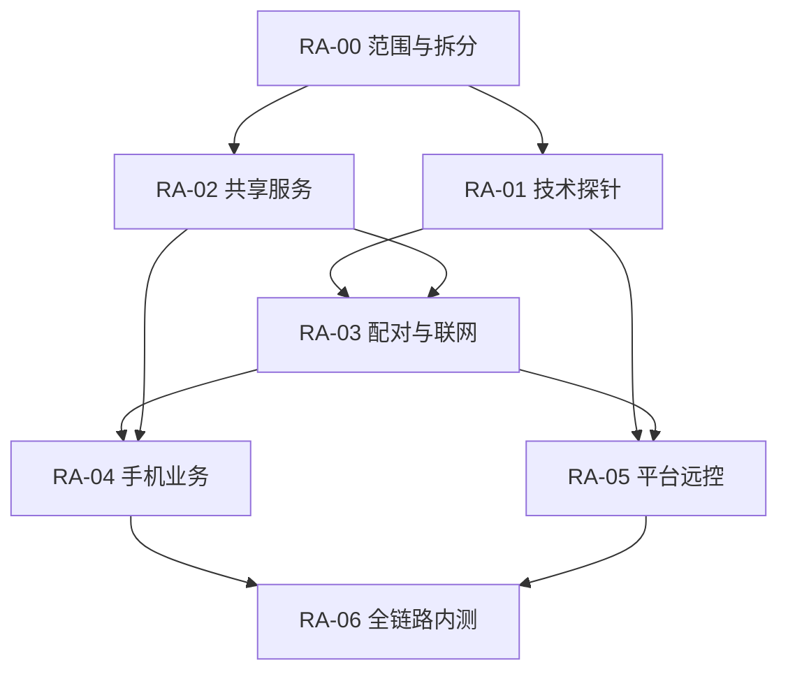

# 远程访问首版：任务拆分与执行顺序

日期：2026-10-16。本文件为已确认需求的执行规格，不表示功能已经实现。当前工作包状态统一维护在 [CURRENT_WORK](../CURRENT_WORK.md)，产品范围与验收原文见 [远程访问方案](remote-access-assessment-2026-10-16.md)。

排程更新：用户决定先完善桌面并在 GitHub 公开源码及 Windows/macOS/Linux 安装包。37 个子任务及需求保留，远程专项后移；RA-02 的本机生命周期、操作可靠性和共享业务状态由当前 [桌面发布任务](desktop-github-release-work-breakdown-2026-10-16.md) DT-08/09/10 提前交付并作为发布门槛。RA-02A/B/C/D/E/F/H 后续复用这些成果，再补配对身份、跨网/Dart 适配等剩余项；不将整包提前标完成。下文顺序为远程阶段恢复后的参考，实施前按已交付基础更新依赖。不提前开展 Flutter、官方服务或远控媒体。

## 1. 交付目标与执行边界

交付 Flutter iOS/Android 内测 App、Windows/macOS/Linux（X11 与 Wayland）宿主能力，以及面向中国大陆和海外小规模试用的官方接入、中继与通知服务。手机同时提供 Coding Agent 业务界面和远程桌面；一次扫码绑定个人设备，无账号登录，无每次连接的 PC 二次确认。

以下范围已确定，不再在实现时自行降级：

- 手机会话、Agent/模型/思考强度选择、流式消息、任务、审批/回答、审查/Diff/Git、终端、项目运行、App 内网页预览。
- 添加项目只选 PC 已有目录；文件界面只浏览项目与上传任务附件；Agent 管理页只显示安装状态与额度，其余管理通过远控。
- 手动双向文本/图片剪贴板、逐屏切换；不做系统音频、麦克风回传、多屏总览或自动剪贴板同步。
- 已登录后无人值守、关闭主窗口继续运行、锁屏保留 Agent 业务；远程解锁、登录前和无显示器桌面后续再做。
- 四类后台通知及电脑/会话静音；独立本地草稿、手动重连发送、最近会话离线缓存；任务/远控期间默认防自动睡眠，可关闭。
- iOS/Android 均内测，官方服务覆盖大陆和海外；首批少量用户，具体容量和预算后续确定。

用户确认 Windows、Linux X11/Wayland、iPhone、Android 实机均可提供。具体系统版本、Linux 桌面、CPU 架构、连接方式和测试账号在 RA-01A 登记，不把“可提供”记为已经连通或验收通过。

本轮只完成任务拆分及文档衔接，不创建生产服务、不采购、不开始实现。后续每项实现以可独立评审的提交为单位；大项可以拆多次提交，但不能仅凭接口桩、模拟数据或单平台 Demo 标记整个工作包完成。

## 2. 当前代码入口与拟议落点

已有入口已按当前目录核对。新增目录是建议落点，尚未创建；RA-02A 确定最小模块边界后再落代码，不先搭大量空 crate。

| 能力 | 现有入口 | 实施落点 |
| --- | --- | --- |
| 契约及核心身份 | `crates/protocol/src/lib.rs`、`packages/protocol/src/index.ts`、`crates/core/src/{lib,artifacts,recovery}.rs` | 扩展现有协议；新增共享服务接口层，贯通可信 RequestContext |
| 本机服务与窗口生命周期 | `apps/desktop/src-tauri/src/{daemon,lib}.rs` | 提取宿主服务，保留本机适配；远程网关不直接暴露 loopback RPC |
| Diff/Git | `crates/workspace/`、`apps/desktop/src-tauri/src/review.rs` 及相关模块 | 复用 Git 引擎，迁移快照、租约与操作编排到共享服务 |
| 文件/附件 | `workspace_browser.rs`、`artifact_export.rs`、`crates/core/src/artifacts.rs` | 共享项目读取/目录注册/附件服务；本机 OS 打开/导出行为保留本机适配 |
| 终端与项目运行 | `terminal.rs`、`project_runs.rs`、`crates/runtime/` | 服务持有 PTY/run 生命周期，窗口和手机只订阅或操作资源 |
| 前端客户端与偏好 | `tauriClient.ts`、`reviewClient.ts`、`projectRunClient.ts`、`historyPreferences.ts`、`historySections.ts`、`agentPreferences.ts` | 统一 TypeScript 客户端契约，端内草稿与宿主共享偏好分开 |
| 手机端（新增） | 当前无手机工程 | 建议 `apps/mobile/`，Flutter 页面、Dart 契约/客户端及平台适配 |
| 网络/身份（新增） | 当前只有本机 RPC 和 PairedDevice 类型 | 建议 `crates/remote-gateway/`、`services/remote-access/`，职责先分清，crate 数量后定 |
| 平台远控（新增） | 不复活悬浮岛代码 | 建议 `crates/remote-desktop/` 与隔离原生 helper；平台 FFI 不放入 Core |
| 技术探针/验收证据（新增） | 复用 `experiments/` 和实施记录约定 | `experiments/remote-access/` 保存可复跑探针；证据按日期、平台和任务 ID 归档 |

RustDesk 只读参考包括 `libs/scrap/`、`libs/enigo/`、`src/server/`，以及 `flutter/lib/mobile/pages/{scan_page,remote_page}.dart`、`flutter/lib/mobile/widgets/`。不复制源文件、资源或协议，不把参考项目的测试结论视为本项目证据。

## 3. 工作包与依赖

| 工作包 | 目标 | 阶段完成门槛 |
| --- | --- | --- |
| RA-00 | 需求收口与任务拆分 | 明确范围、任务依赖、30 项验收覆盖及执行入口；本次交付 |
| RA-01 / P0 | 技术探针与选型 | 四条宿主平台路径、两种手机平台、预览桥接、网络及推送的实测结论和兼容矩阵 |
| RA-02 / P1 | 统一服务与桌面适配 | 桌面从共享服务完成原有操作；身份、资源和进程生命周期脱离窗口 |
| RA-03 / P2 基础 | 配对与跨网连接 | 官方服务路由、端到端身份验证、撤销、事件恢复及 PC 配对入口 |
| RA-04 / P2 客户端 | Flutter 手机业务 | 已确认业务、预览、通知、草稿和离线缓存均可操作真实宿主 |
| RA-05 / P3 | 跨平台远程桌面 | Windows/macOS/X11/Wayland 与 iOS/Android 上完成画面、键鼠、切屏及剪贴板验收 |
| RA-06 / P4 | 全链路与内测交付 | 30 项验收有证据，三平台 PC 与两端手机可安装，大陆/海外小规模试用可复查 |

图中为包级依赖；实际按下面任务依赖逐项进入，不要求等整个 RA-01 完成后才启动 RA-02。平台探针与共享服务可以交错推进，首次手机业务链路不必等待全部桌面媒体后端。技术上可并行不代表本次启动多 Agent 执行。

首条可验证的业务链路为：PC 显示二维码 → 手机在不同网络扫码 → 认证读取项目/会话 → 发送任务 → 流式显示 → 在手机响应一次审批 → PC 同步结果 → 撤销手机后拒绝后续访问。未经配对鉴权的公开执行接口不能作为这条链路的中间交付。

## 4. RA-01：探针任务

探针必须给出候选方案、真实结果、失败原因和推荐选择；编译成功不能替代真机通过。所有 ID 是后续提交与证据的引用标识。

| ID | 依赖 | 工作与产物 | 完成条件 |
| --- | --- | --- | --- |
| RA-01A 环境与现状基线 | RA-00 | 登记两端手机、Windows/macOS、Linux X11/GNOME Wayland/KDE Wayland 的可用环境；记录当前 Git 状态、服务/数据隔离方式及相关基线测试；列明缺少的 SDK、签名和设备连接条件 | 设备矩阵有版本、架构、桌面、操作者/访问方式；可用与待配置分开；已有用户数据与未提交改动不被测试覆盖 |
| RA-01B 配对与传输探针 | RA-01A | 用最小请求/回执验证二维码信任、成熟加密握手、WSS 路由及 ICE/TURN；两端绑定身份与媒体指纹；给出技术选型记录 | 验证一次性凭证、身份替换/重放失败、不同网络、强制中继、禁 UDP 回退和断线；示例密钥与生产密钥隔离；原型不开放终端/业务执行 |
| RA-01C 四平台宿主探针 | RA-01A | 分别保存 Windows、macOS、X11、Wayland 四份采集/键鼠/文本/光标/显示器/剪贴板/锁屏/防睡眠报告；候选实现封装在探针内 | 四条路径均在真实桌面完成最小查看与输入；Wayland 记录合成器及 Portal 能力；输出最低版本候选及失败清单，不能用 XWayland 替代 X11 后端 |
| RA-01D Flutter 媒体与输入探针 | RA-01A；联调依赖 RA-01B/RA-01C 的可用路径 | 最小 iOS/Android 工程，验证视频解码、触摸/拖拽/滚轮、中文输入、键盘遮挡、横竖屏、文本/图片剪贴板、前后台重连；比较 Dart 与 Rust FFI 接入边界 | 两端实机均能交互；记录性能和库兼容性，不只在模拟器或单一平台通过；原型不直接当正式 UI |
| RA-01E 项目预览探针 | RA-01A；认证转发复用 RA-01B | 验证 Flutter WebView 到端到端转发通道的桥接；静态页面、API 请求、Cookie、重定向、WebSocket 热更新与不同项目 origin | iOS/Android 在非同网环境能加载并交互；页面不能调用手机/宿主特权接口，转发不成为开放代理；给出支持范围及不可用场景 |
| RA-01F 推送与地区探针 | RA-01A；需配置测试通知凭据 | 实测大陆/海外 iOS/Android 的后台通知及点击恢复；比较所需推送渠道、签名和分发环境，记录内容最小化方式 | 四类事件均有可达路径和实测条件；断网、权限拒绝、延迟/重复、App 退出后的实际行为有记录，不保证平台强制停止时必达 |

RA-01C 每个平台可以独立提交证据，全部完成才关闭该项。若某个关键技术路径不可行，应先给出等价替代方案；会删减已确认功能时再与用户讨论，不能暗中延期 X11 或任一手机平台。

## 5. RA-02：共享服务与桌面回归

| ID | 依赖 | 工作与代码范围 | 交付与验收 |
| --- | --- | --- | --- |
| RA-02A 契约、身份与模块边界 | RA-00 | 核对全部日常操作并建立 UI → 接口 → 服务 → 存储映射；扩展 protocol，设计 RequestContext、资源 ID/epoch、错误、能力、requestId/operationId；定稿共享服务最小模块 | 提交可评审契约和 Rust/TS/Dart 同源 fixtures；本地身份与 PairedDevice 不混淆；首次 schema 可只覆盖会话链路但有完整域清单和后续负责人任务 ID |
| RA-02B 宿主生命周期 | RA-02A | 从 `daemon.rs`/`lib.rs` 抽离共享服务持有者；区分关闭主窗口、退出后台、系统注销和重启；建立订阅与资源租约 | 本机调用保持可用；关闭 UI 不杀任务，显式退出有可观察结果；保留 loopback 边界，不把本机 token 当公网凭证；宿主重启后旧资源 epoch 失效 |
| RA-02C 会话、审批、历史与偏好 | RA-02A/RA-02B | 贯通 core/artifacts/recovery 的可信身份；共享置顶/归档等业务偏好；模型/思考强度草稿保持端内；保留审查、永久删除和 Fork 语义 | 两客户端审批竞争只一次成功；事件先接 live 再 replay、去重和缺口补齐；远程主体不能伪造 LocalUser；用户原生 Agent 权限选项不被 Hub 改写 |
| RA-02D 目录、文件与附件 | RA-02A/RA-02B | 抽离 workspace_browser/附件操作；已有目录浏览/注册和重复检测；项目只读浏览与监听；任务附件受控上传和回收 | 路径/符号链接、权限、宿主隔离与资源归属通过；观察者断开只释放订阅；不新增通用文件写 API；上传中断不产生可误用的完整附件 |
| RA-02E Diff/Git 与操作记录 | RA-02A/RA-02B | 复用 workspace 引擎；迁移 ReviewHost 快照/租约；阶段性抽离暂存/丢弃/提交/推送及提交文案；以实际桌面能力为准补齐契约 | 预览过期与并发修改检查；记录提交和推送各自结果；回执丢失可查询，结果未知不盲重试；不能把任务接收状态显示为 Git 成功 |
| RA-02F PTY 与项目运行 | RA-02A/RA-02B | 从 terminal/project_runs 提取服务持有的 terminalId/runId、attach/detach、输出 offset/epoch、退出和进程组回收；目录与运行项复用已有分析能力 | UI/手机离开不杀进程，显式停止回收自身子进程；输出缺口可识别并恢复屏幕；重启不假装重建已丢失 PTY；手机可重新定位实际运行实例 |
| RA-02G 默认防自动睡眠 | RA-02B；平台策略参考 RA-01C | 后台统一保活请求与开关；引用活动任务和远控会话，区分锁屏、屏幕休眠和系统睡眠；平台调用隔离 | 默认开启且可关闭；多任务、等待交互、窗口关闭、结束/断开/退出均正确释放；失败如实报告。长期项目服务的保活策略必须有明确状态规则，不能意外永久持有 |
| RA-02H 桌面传输与回归 | 随 RA-02C/RA-02D/RA-02E/RA-02F 分域推进，收口依赖 RA-02G | Tauri 留薄适配，统一 Core/Review/Run/Terminal 客户端；移除组件直接绕过共享服务的业务路径；保持现有 UI 约定 | PC 会话、审查、Diff/Git、文件、终端、运行项目均经过共享服务；相关前端/Rust 测试和隔离桌面验收通过，无新增悬浮岛入口 |

数据库仍遵守 [开发阶段策略](database-initialization.md)：新结构在隔离空库初始化，已有库不自动补表、迁移或清空。新增共享偏好需定义现有端内偏好的保留/显式导入方式，不能借重构悄悄丢失设置。内测版本间若必须升级持久数据，RA-06B 需先提交策略调整方案，不能与当前规则相冲突。

## 6. RA-03：配对、网关与官方服务

| ID | 依赖 | 工作与代码范围 | 交付与验收 |
| --- | --- | --- | --- |
| RA-03A 设备身份与配对状态机 | RA-01B、RA-02A/RA-02B | 实现设备密钥存储、二维码短期凭证、并发消费、回执丢失核实、配对持久化和撤销；首版整体授权 | QR 过期/关闭/重生成/用过均失效；手机固定 PC 身份；不记录一次性密钥；撤销关闭订阅及输入租约，但不自动回滚已开始的业务操作 |
| RA-03B 官方接入与路由 | RA-01B、RA-02A，联调 RA-03A | 新增官方服务进程、配置和本地部署样例；设备接入认证、临时配对路由、限流、会话路由、短期 TURN 授权和最少诊断元数据 | 未配对设备只可进行受限配对握手，不能访问业务；配对 ID/设备 ID 不等于授权；端点密文转发，不向公共用户开放无限中继；先隔离测试部署 |
| RA-03C 可靠远程传输 | RA-03A/RA-03B、RA-02C | 宿主主动出站，Dart/TS 按同一协议连接；请求回执、operationId 查询、事件游标、背压、网络切换和身份绑定；媒体信令独立 | 直连/中继路径变化不改变主体；任务发送后断线只核实不重复执行；远程失败不冒充本地身份、不将运行中任务标完成；业务不依赖屏幕流 |
| RA-03D PC 配对与设备 UI | RA-03A/RA-03C、RA-02H 的基础接入 | PC“连接手机”、二维码生命周期、完整授权说明、设备列表/重命名/撤销、后台与保活状态 | 扫码即绑定；后续无每次 PC 确认；扫码成功反馈、关闭作废、撤销立即生效；本机可中止远控，保持主窗口既有交互规则 |

先完成 RA-03A 与 RA-03B 的测试实例联调，再启用真实业务执行。正式服务证书、节点和费用配置归 RA-06C，不在基础功能测试中隐式创建生产资源。

## 7. RA-04：Flutter 手机业务

正式手机工程建议放在同仓库 `apps/mobile/`，便于契约一起修改和验证；是否复用 Rust 传输取 RA-01 的结论。按业务拆页面与状态，不把桌面 DOM 或整套 RustDesk UI 嵌入手机。

| ID | 依赖 | 工作与产物 | 交付与验收 |
| --- | --- | --- | --- |
| RA-04A 工程与 Dart 客户端 | RA-02A、RA-01D 的选型结果 | Flutter iOS/Android 构建骨架、契约生成/解码、连接错误与能力模型；安全存储适配、测试 transport | 两端可构建启动；Rust/TS/Dart fixtures 一致，64 位序号不丢精度；不把正式证书或密钥入库 |
| RA-04B 设备与项目 | RA-04A、RA-03C、RA-02D，真机扫码依赖 RA-03D | 扫码、设备卡片、多 PC 切换、在线状态、已有目录添加项目；安装状态和额度只读页 | 请求、缓存与页面以 hostId 隔离；目录添加不创建或克隆；额度未知不伪装为零；进入远控管理的入口可用后再接 RA-05F |
| RA-04C 会话、流式内容和审批 | RA-04B、RA-02C | 会话创建/列表/历史/搜索/重命名/归档/删除/Fork、Agent/模型/思考强度、任务发送/取消、工具与消息渲染、审批/回答 | 真宿主完成首条业务链路；原生审批选项准确；成功/失败/取消/等待区分，增量流和重连不重复；已删除或活动任务限制沿用 PC 语义 |
| RA-04D 文件、附件与只读状态 | RA-04B、RA-02D | 项目树、文件预览与搜索、刷新；系统选择器上传任务附件；安装/额度数据接入 | 无编辑/删除/任意文件传输入口；附件 ID 随任务提交，失败可重试或重新选择；源文件变化能刷新，手机路径不能到 PC 执行 |
| RA-04E 审查、Diff 与 Git | RA-04C、RA-02E | 审查发起/流式结果/取消/选择问题修复、文件 Diff、暂存/取消暂存、提交和推送、操作状态 | 保留来源上下文和已有修复回主 Agent 语义；提交暂存策略明确；提交成功推送失败能分步重试；网断结果未知可查询而不重复提交 |
| RA-04F 终端、项目运行与预览 | RA-04B、RA-02F、RA-01E、RA-03C | 手机终端输入/尺寸/输出恢复；项目运行项与日志；新增宿主 preview 服务、认证转发、App 内 WebView 和热更新 | 项目与 PTY 后台继续；退出网页预览不等于停止项目，显式停止关闭服务转发；origin/存储隔离和 WebSocket 路径验收；不把开发服务器公开匿名发布 |
| RA-04G 草稿与离线缓存 | RA-04C/RA-04D | 本地草稿/附件选择/待发送选项；最近会话缓存、同步时间、清除与配对隔离 | 离线重启后可恢复，联网不自动发送；历史与草稿分开清除；跨端草稿互不覆盖，撤销/删除已知后清理对应缓存，不声称可远程擦除离线手机 |
| RA-04H 后台通知与静音 | RA-01F、RA-03B/RA-03C、RA-04C | 官方通知派发、token/设备绑定、四类事件、按电脑/会话静音、去重、点击定位和实时核实 | 两端实际后台接收；静音不隐藏 App 待办；不在通知上批准操作，过期/已处理通知不复活审批；正文和凭证不泄漏到普通推送 payload |

RA-04E 的 Git 操作按 PC 已有能力逐项映射；方案中的方法名是候选，不为了补齐方法名额外扩展 PC 尚不具备的 Git 产品功能。新增手机 UI 覆盖已确认日常操作，不重复实现 Agent 驱动。

## 8. RA-05：平台远控正式实现

| ID | 依赖 | 工作与产物 | 交付与验收 |
| --- | --- | --- | --- |
| RA-05A 会话、媒体及控制租约 | RA-01B/RA-01D、RA-02A/RA-02B、RA-03C | 统一 capture/input 接口、显示器 revision、会话状态、媒体身份绑定、码率/背压、一个有效控制租约、断线释放 | 旧 epoch 输入不能注入；多查看者与控制者分清；点击含坐标且可靠有序，移动可合并；媒体失败不终止 Agent；不启用音频轨 |
| RA-05B Windows 后端 | RA-01C Windows 结论、RA-05A | 登录用户 helper、采集/编码候选、键鼠/文本、光标、多屏、锁屏检测和错误适配 | Windows 真实登录桌面可用；权限/显示器变化和断线状态正确；不承诺 UAC 安全桌面或登录前控制 |
| RA-05C macOS 后端 | RA-01C macOS 结论、RA-05A | 系统采集、输入及授权检测、用户 helper、签名后授权稳定性 | 系统拒绝/撤销权限可恢复；锁屏暂停输入/画面但 Agent API 可用；不把开发运行授权视为安装包授权通过 |
| RA-05D Linux X11 后端 | RA-01C X11 结论、RA-05A | 独立 X11 捕获/键鼠/文本/光标、会话环境、显示器变化及依赖探测；只借鉴 RustDesk 思路 | X11 必须单独真实验收；缺库/连接失败有明确错误，资源释放正确；多屏/负坐标和布局变化不误点 |
| RA-05E Linux Wayland 后端 | RA-01C Wayland 结论、RA-05A | Portal/PipeWire 与选定输入路径，恢复令牌、桌面差异和权限状态；不以 X11 注入冒充支持 | 声明支持的 GNOME/KDE 环境分别验证；拒绝/授权失效有真实状态，系统再次询问不被隐藏；锁屏保留业务 |
| RA-05F 手机远控 UI | RA-04A/RA-04B、RA-05A，先接一个可用后端后覆盖四条路径 | 画面、缩放/平移、直接触摸或触控板映射、拖拽/右键/滚动、快捷键/中文、横竖屏、逐屏切换、连接/锁屏提示 | iOS/Android 能操作真实浏览器/编辑器；切屏释放输入、旧布局拒绝；键盘不遮挡必要操作；退出远控不退出业务任务 |
| RA-05G 文本/图片剪贴板 | RA-01C/RA-01D、RA-05A/RA-05F，联调四个平台后端 | 手动获取/发送、格式协商、大小/像素预算、临时资源和平台适配；明确写入成功不等于应用已粘贴 | 两端手机与四条宿主路径双向文本/图片；超限、空内容、拒绝、撤销/断线和切电脑正确处理；不自动同步、粘贴或重放 |

FFI 放在范围明确的 native helper/适配模块，保持 Core 的 `unsafe_code = forbid`。X11 原评估 10～20 人日是公共链路完成后的增量参考，不作为 RA-01 至 RA-06 的总工期；此处不按代码行数推算完整工程时间。

## 9. RA-06：验收、发布与试用

| ID | 依赖 | 工作与产物 | 交付与验收 |
| --- | --- | --- | --- |
| RA-06A 故障、并发与全链路 | 随 RA-02 至 RA-05 增量执行，收口需全部正式功能 | 30 项用例的自动化与人工实机矩阵；延迟/丢包/断连/进程退出/撤销/跨端竞争注入；性能和资源记录 | 每条范围有代码版本、环境、步骤、结果及证据；不存在把失败评审标完成、重复 Git、副作用重放或释放失败的已知阻断问题；未覆盖如实保留 |
| RA-06B 安装包与内测分发 | 构建可早于功能完成；收口依赖 RA-06A | 三平台 PC 包、iOS/Android 内测包、helper/后台服务安装卸载、第三方依赖清单、可复现构建与兼容版本协商；衔接 R1–R3 | 脱离开发服务器可用；关闭/退出语义正确；权限和密钥保留策略可复查；升级不会静默擦除配对/历史。签名/发布凭据实际可用后才标对应项通过 |
| RA-06C 官方服务试运行 | RA-03B、RA-04H、RA-01 地区数据；实际资源配置需预算明确 | 按大陆/海外实测选择节点、TURN 与推送渠道；隔离测试/生产配置、认证限额、监控告警、脱敏日志及恢复说明 | 用真实移动网络验证本地与跨地区路径；费用/资源上限可观察，中继与通知不向匿名用户开放；主机离线不伪造在线，预算未定不先作付费部署 |
| RA-06D 小规模试用收口 | RA-06A/RA-06B/RA-06C | 个人与少量用户试用，故障反馈、直连率/延迟/流量/资源占用、兼容矩阵及后续成本建议 | 原定功能在声明支持环境内通过，形成已知限制和可安装内测交付；正式商店上架单独推进，不能用未来上架承诺代替当前包验证 |

## 10. 远程阶段恢复后的实施顺序

1. **RA-01A：建立基线和实机矩阵。** 当前环境为 macOS；逐一登记用户可提供设备。准备隔离数据及最小样例项目，不先执行真实用户任务。
2. **RA-02A：先定接口与身份，再抽服务。** 第一份评审产物包含现有命令清单、可信身份来源、资源生命周期、错误/事件示例以及 Rust/TS/Dart 契约样本；不给 UI 添加临时公网 invoke。
3. **RA-02B/RA-02C 与 RA-01B/RA-01D：推进最小会话链路。** 共享会话/审批先可本地测试；配对、路由和手机最小客户端独立验证后连接，尽早验证跨网操作。
4. **RA-03A 至 RA-03D + RA-04A 至 RA-04C：跑通真实扫码、发送、流式消息和审批。** RA-01B 原型不会替代正式网关和撤销实现。
5. **按依赖补齐业务和平台路径。** Git/PTY/预览/通知各自完成后接入手机；平台探针持续推进，RA-05 正式实现不必等待所有手机业务页面完成。
6. **RA-06：收口矩阵、内测包与官方试运行。** 先复核并复用桌面阶段已完成的 R1–R3 成果，补齐手机与服务部分，不重复建设；原 RA 依赖表按届时代码更新。

每个任务开工前查看当前树与已有变更，避免重复或覆盖其他工作。工作包完成状态以 CURRENT_WORK 为准；在实施证据中逐条记录子任务 ID 的结果，不能只写“整体通过”。

## 11. 验收追踪与检查方法

下表编号对应 [方案第 9 节](remote-access-assessment-2026-10-16.md#9-建议的核心验收用例)，不另复制一份可漂移的用例正文。

| 用例 | 实现主责任务 | 验证重点 |
| --- | --- | --- |
| 1 | RA-02C、RA-04C | 会话、选择与流式状态一致 |
| 2 | RA-02C、RA-03A | 审批竞争、过期及撤销 |
| 3 | RA-02E、RA-04E | 暂存、提交、推送与结果核实 |
| 4 | RA-02F、RA-04F | 终端/项目持有与重新附着 |
| 5 | RA-02B、RA-02H | 窗口与后台生命周期 |
| 6 | RA-05A 至 RA-05E | 系统授权和显示布局 |
| 7 | RA-05A、RA-05F | 断线释放，不回放输入 |
| 8 | RA-03C、RA-05A | 背压与业务优先级 |
| 9 | RA-02A、RA-03A/RA-03C | 身份与版本协商 |
| 10 | RA-03A/RA-03D、RA-04B | 扫码及重连 |
| 11 | RA-03A | 一次性凭证状态机 |
| 12 | RA-03A/RA-03B | 身份替换、重放与日志 |
| 13 | RA-03A/RA-03C、RA-05A | 撤销与会话终止 |
| 14 | RA-03B/RA-03C、RA-06C | 不同网络与中继回退 |
| 15 | RA-03C、RA-04G/RA-04H | 恢复真实状态 |
| 16 | RA-05D/RA-05E | X11 与 Wayland 分别验收 |
| 17 | RA-02B/RA-02G、RA-05B 至 RA-05E | 锁屏与业务独立 |
| 18 | RA-04A/RA-04B、RA-06A | 两端手机及多宿主隔离 |
| 19 | RA-03D、RA-04C | 完整配对授权不替代原生审批 |
| 20 | RA-01E、RA-04F | App 内项目预览 |
| 21 | RA-02D、RA-04B/RA-04D | 文件与 Agent 原生页边界 |
| 22 | RA-05G | 双向文本/图片剪贴板 |
| 23 | RA-05A/RA-05F | 切屏及无音频 |
| 24 | RA-01F、RA-04H | 通知与静音 |
| 25 | RA-03C、RA-04G | 草稿不自动发送 |
| 26 | RA-02C、RA-04G | 跨端独立草稿 |
| 27 | RA-01B/RA-01F、RA-06C/RA-06D | 大陆/海外试用 |
| 28 | RA-02D、RA-04B | 已有目录添加项目 |
| 29 | RA-04G | 离线缓存与清除 |
| 30 | RA-02G、RA-06A | 默认保活与释放 |

代码检查按改动选择现有前端 typecheck/Vitest、相关 Rust 测试、fmt/Clippy；新增 Flutter 代码再加入 analyze、单元/widget 测试及必要的设备集成测试。使用跨语言 golden fixtures 验证协议，使用真实进程/临时 Git 仓库验证副作用，不用完全模拟的测试证明进程、Git 或系统权限可靠。

现有数据库采用隔离空库；测试不动用户生产 Agent 登录、安装和项目。真实供应商只做完成目标所需的代表性流式/审批验证，协议与并发尽量使用确定性驱动，不每次穷举所有供应商。平台权限、锁屏、输入法、剪贴板、推送和安装包必须有实际环境证据。

## 12. 后续需要讨论的触发条件

- 用户已确认所有类别设备可提供；RA-01A 若发现具体版本或接入方式缺失，按需索取环境信息，不重新询问是否支持该平台。
- 技术探针若要求删减任一已确认功能、改为每次 PC 确认，或改变“无账号扫码”的流程，先展示失败证据与可选方案，再讨论。
- 部署、推送或内测分发确实需要账号、证书、域名、费用时，先完成可本地验证的配置与方案，再列明缺少条件；不将产品免登录误解为开发/发布也无需平台凭据。
- 持久化数据升级若与当前未发布数据库策略冲突，先提出保护现有数据的具体方案；不为适配试用自动清库。
- 画质、连接性能及限额用探针实测制定；若无法满足手机阅读代码、流畅点击和任务操作，再讨论产品取舍，不凭经验数字冒充已验证目标。

其余模块命名、状态机细节、测试组织及库选择由实现阶段依据证据决定，保持当前范围即可。
